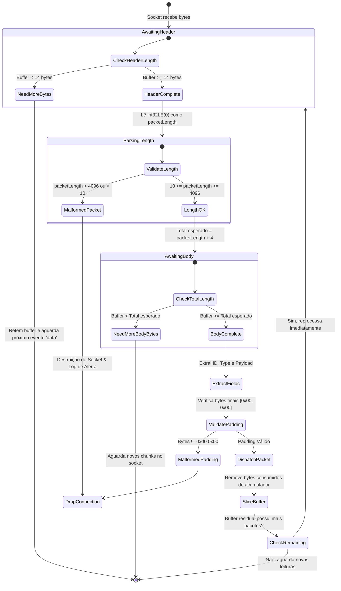
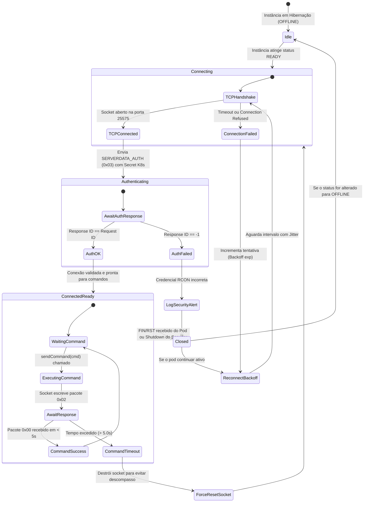
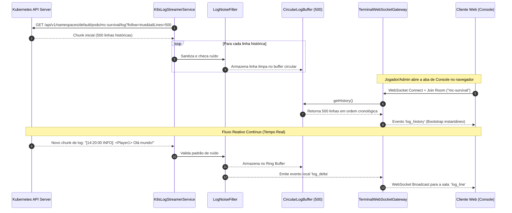
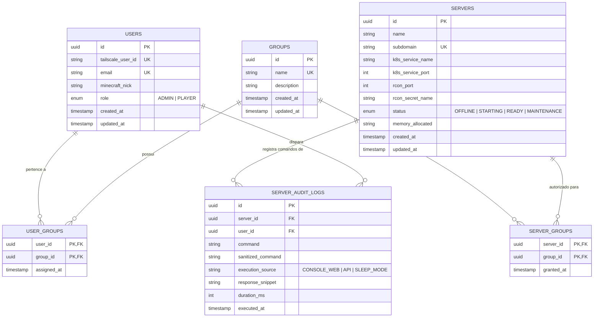

# Especificação de Requisitos de Software e Arquitetura de Sistemas (SRS)
## Módulo Driver RCON Binário Persistente, Pipeline Reativo de Logs & Control Plane TypeORM

---

### Sumário Executivo e Metadados do Módulo
- **Projeto:** MineKubernetes — Next-Gen Game Server Hypervisor
- **Subsistema:** Binary TCP RCON Driver, Reactive Log Engine & TypeORM Domain Control Plane
- **Linguagem & Runtime:** TypeScript / Node.js (v22+ LTS), NestJS Framework
- **ORM & Persistência:** TypeORM (Data Mapper Pattern, SQLite para desenvolvimento/homelab, PostgreSQL para produção)
- **Perfil do Documento:** Especificação Técnica Formal de Engenharia, Contratos Binários de Rede, Arquitetura Reativa de Eventos e Matriz de Persistência Relacional
- **Documentos Relacionados:**
  - [SRS-ARQUITETURA-HYPERVISOR.md](SRS-ARQUITETURA-HYPERVISOR.md) (Arquitetura Geral do Hypervisor & Ciclo de Vida)
  - [SRS-GATEWAY-L7.md](SRS-GATEWAY-L7.md) (Gateway Reverso TCP L7 & Protocolo Minecraft em Rust)
  - [SRS-SUBSISTEMA-TAILSCALE.md](SRS-SUBSISTEMA-TAILSCALE.md) (Rede Mesh Tailscale & Identidade Zero-Trust)

---

## 1. Visão Geral e Diagnóstico de Engenharia Reversa

### 1.1 Diagnóstico Crítico do Sistema Legado
No sistema legado (v1), o gerenciamento de console e a telemetria de logs foram construídos com atalhos de desenvolvimento que introduziram graves falhas de segurança e severos gargalos de desempenho:

1. **Vulnerabilidade Crítica de RCE (Remote Code Execution):**
   - O código legado executava comandos de console através de interpolação direta de strings em interpretadores de shell do sistema operacional:
     ```typescript
     // CÓDIGO LEGADO VULNERÁVEL (servers.service.ts:404)
     await execAsync(`kubectl exec ${podName} -- rcon-cli "${command}"`);
     ```
   - Esta abordagem permitia que qualquer usuário mal-intencionado escapasse as aspas duplas com `"; rm -rf / ; #` ou utilizasse subshells `$(comando_arbitrario)` para obter execução remota de código arbitrário no nó hospedeiro do cluster Kubernetes.

2. **Sobrecarga Massiva de Latência e CPU por Invocação de Processos:**
   - Cada comando disparado (incluindo comandos internos automatizados, como o `/list` invocado a cada 5 minutos pelo serviço de hibernação `sleep-mode.service.ts` e pelas páginas de administração) forçava o sistema operacional a:
     - Fazer `fork + exec` de um novo processo `kubectl` em Node.js.
     - Autenticar contra a API Server do Kubernetes via TLS.
     - Abrir um stream multiplexado SPDY remoto para dentro do pod.
     - Iniciar o binário `rcon-cli` dentro do container da JVM.
     - Abrir um socket TCP local com o Minecraft, autenticar e despachar o comando.
     - Destruir toda essa cadeia de conexões e processos.
   - O custo operacional resultava em **dezenas a centenas de milissegundos de latência** e saturação desnecessária de descritores de arquivo e CPU.

3. **Gargalo de Polling HTTP e Filtragem Client-Side de Logs:**
   - O console web executava requisições HTTP periódicas a cada 3 segundos (`polling`) buscando logs brutos da API do Kubernetes.
   - O navegador recebia centenas de linhas contendo ruído gerado pelas próprias consultas repetitivas de RCON (ex.: `"Thread RCON Client /127.0.0.1:xxxxx shut down"`), exigindo filtros de regex lentos em JavaScript no lado do cliente para mascarar o ruído visual.

### 1.2 A Solução Arquitetural da Nova Geração
O novo módulo elimina 100% do acoplamento com shells do sistema operacional, introduzindo comunicação binária nativa e reatividade orientada a eventos:

```mermaid
flowchart TB
    subgraph UI ["Camada de Apresentação (Frontend SPA)"]
        WebTerminal["Terminal Virtual / Console Web (Xterm.js / WebSocket)"]
        AdminControls["Painel de Controle Administrativo (REST / WebSocket)"]
    end

    subgraph ControlPlane ["Control Plane & Hypervisor Core (TypeScript / NestJS)"]
        TerminalWS["Terminal WebSocket Gateway (/ws/servers/:id/terminal)"]
        CommandSanitizer["Sanitizador Binário Anti-RCE & Validador de Regras"]
        
        subgraph RconEngine ["Motor RCON Binário Persistente"]
            RconPool["Pool de Conexões Persistentes TCP (RconConnectionPool)"]
            RconCodec["Codec Binário Source RCON (Little-Endian)"]
        end

        subgraph LogEngine ["Pipeline Reativo de Logs"]
            K8sStreamer["K8s Pod Log Stream Consumer (Follow Engine)"]
            NoiseFilter["Supressor de Ruído de Fundo (LogFilter)"]
            RingBuffer["Buffer Circular em Memória (500 Linhas / RingBuffer)"]
        end

        subgraph DomainPersistence ["Camada de Persistência (TypeORM)"]
            DataSource["TypeORM DataSource (SQLite / PostgreSQL)"]
            ServerRepo["Server Repository"]
            AuditRepo["ServerAuditLog Repository"]
            UserRepo["User / Group Repository"]
        end
    end

    subgraph ClusterK8s ["Cluster de Execução (Kubernetes / Pods de Jogos)"]
        PodJVM["Pod Minecraft (Paper / Purpur / Vanilla)"]
        RconSocket["TCP Socket :25575 (RCON Server Interno)"]
        StdStream["Contêiner Stdout / Stderr"]
    end

    WebTerminal <-->|WebSocket Duplex (Deltas de Log & Comandos)| TerminalWS
    AdminControls -->|REST API| CommandSanitizer

    TerminalWS --> CommandSanitizer
    CommandSanitizer --> RconPool
    RconPool <-->|Binary Protocol via net.Socket| RconCodec
    RconCodec <-->|Conexão TCP Direta :25575| RconSocket

    StdStream -->|HTTP Stream (follow: true)| K8sStreamer
    K8sStreamer --> NoiseFilter
    NoiseFilter --> RingBuffer
    RingBuffer -->|Snapshot Inicial no Connect| TerminalWS
    NoiseFilter -->|Broadcast de Linha Nova| TerminalWS

    CommandSanitizer -->|Auditoria de Comandos| AuditRepo
    AuditRepo --> DataSource
    ServerRepo --> DataSource
    UserRepo --> DataSource
    RconSocket --- PodJVM
    StdStream --- PodJVM
```

---

## 2. Especificação do Protocolo Binário Source RCON

O protocolo Source RCON (utilizado nativamente pelo servidor dedicado de Minecraft) opera sobre soquetes TCP na porta `25575`, codificado em formato binário Little-Endian estrito.

### 2.1 Estrutura de Pacotes Binários (Wire Format)

Todo pacote RCON possui um cabeçalho fixo de 12 bytes seguido pelo payload de texto e dois terminadores nulos:

```
 0                   1                   2                   3
 0 1 2 3 4 5 6 7 8 9 0 1 2 3 4 5 6 7 8 9 0 1 2 3 4 5 6 7 8 9 0 1
+-+-+-+-+-+-+-+-+-+-+-+-+-+-+-+-+-+-+-+-+-+-+-+-+-+-+-+-+-+-+-+-+
|                      Packet Length (i32-LE)                   |
+-+-+-+-+-+-+-+-+-+-+-+-+-+-+-+-+-+-+-+-+-+-+-+-+-+-+-+-+-+-+-+-+
|                      Request ID (i32-LE)                      |
+-+-+-+-+-+-+-+-+-+-+-+-+-+-+-+-+-+-+-+-+-+-+-+-+-+-+-+-+-+-+-+-+
|                      Packet Type (i32-LE)                     |
+-+-+-+-+-+-+-+-+-+-+-+-+-+-+-+-+-+-+-+-+-+-+-+-+-+-+-+-+-+-+-+-+
|                                                               |
|                   Payload String (UTF-8)                      |
|                                                               |
+-+-+-+-+-+-+-+-+-+-+-+-+-+-+-+-+-+-+-+-+-+-+-+-+-+-+-+-+-+-+-+-+
|    0x00 (Terminador de String) |    0x00 (Pad Obrigatório)    |
+-+-+-+-+-+-+-+-+-+-+-+-+-+-+-+-+-+-+-+-+-+-+-+-+-+-+-+-+-+-+-+-+
```

#### Descrição dos Campos:
| Campo | Tipo / Tamanho | Descrição e Validação |
| :--- | :--- | :--- |
| **`Packet Length`** | `int32` (Little-Endian, 4 bytes) | Número total de bytes subsequentes no pacote. Fórmula: `4 (ID) + 4 (Type) + strlen(Payload) + 2 (Null Bytes)`. Tamanho total em fio: `Packet Length + 4`. |
| **`Request ID`** | `int32` (Little-Endian, 4 bytes) | Identificador inteiro monotonicamente crescente gerado pelo cliente para correlacionar requisições e respostas. Em caso de falha de autenticação, o servidor responde com ID `-1`. |
| **`Packet Type`** | `int32` (Little-Endian, 4 bytes) | Identificador de operação (OpCode) do protocolo RCON. |
| **`Payload`** | String UTF-8 de tamanho variável | Comando a ser executado ou corpo da resposta. Não pode conter caracteres nulos intermediários (`\0`). |
| **`Padding / 2x Null`** | 2 bytes literais (`0x00 0x00`) | O primeiro byte nulo finaliza a string UTF-8; o segundo byte atua como delimitador final do frame de protocolo. |

### 2.2 Tabela de Tipos de Pacotes (OpCodes)
| Código (Hex / Dec) | Constante Simbólica | Direção | Propósito |
| :--- | :--- | :--- | :--- |
| `0x03` / `3` | `SERVERDATA_AUTH` | Cliente $\to$ Servidor | Handshake de autenticação contendo a senha do RCON no payload. |
| `0x02` / `2` | `SERVERDATA_AUTH_RESPONSE` | Servidor $\to$ Cliente | Confirmação de autenticação. Retorna o mesmo `Request ID` se a senha for válida, ou `-1` se recusada. |
| `0x02` / `2` | `SERVERDATA_EXECCOMMAND` | Cliente $\to$ Servidor | Solicitação de execução de comando de console (ex.: `"whitelist add Steve"`). |
| `0x00` / `0` | `SERVERDATA_RESPONSE_VALUE` | Servidor $\to$ Cliente | Saída de texto textual retornada pela execução do comando. |

---

## 3. Máquina de Estados e Codec Binário em Memória

### 3.1 Tratamento de Fragmentação TCP e Chunking
Soquetes TCP são orientados a fluxos contínuos de bytes (*byte streams*), sem garantia de preservação de fronteiras de mensagens. Um único pacote RCON pode chegar dividido em múltiplos chunks ou múltiplos pacotes podem chegar aglutinados no mesmo buffer de leitura.

O decodificador `RconPacketCodec` opera como uma máquina de estados com buffer cumulativo:



### 3.2 Implementação do Codec Binário TypeScript
```typescript
export interface RconPacket {
  id: number;
  type: number;
  body: string;
}

export class RconPacketCodec {
  public static readonly HEADER_SIZE = 12; // Length (4) + ID (4) + Type (4)
  public static readonly MIN_PACKET_SIZE = 10; // ID(4) + Type(4) + Empty Body(0) + 2 nulls
  public static readonly MAX_PACKET_SIZE = 4096;

  /**
   * Codifica um pacote RCON binário garantindo integridade Little-Endian.
   */
  public static encode(packet: RconPacket): Buffer {
    if (packet.body.includes('\0')) {
      throw new Error('RCON Security Violation: Null-byte injection detected in command payload');
    }

    const bodyBuffer = Buffer.from(packet.body, 'utf-8');
    const packetLength = 4 + 4 + bodyBuffer.length + 2;

    if (packetLength > this.MAX_PACKET_SIZE) {
      throw new Error(`RCON Packet Length (${packetLength}) exceeds maximum of ${this.MAX_PACKET_SIZE} bytes`);
    }

    const buffer = Buffer.alloc(packetLength + 4);
    buffer.writeInt32LE(packetLength, 0);
    buffer.writeInt32LE(packet.id, 4);
    buffer.writeInt32LE(packet.type, 8);
    bodyBuffer.copy(buffer, 12);
    buffer.writeUInt8(0, 12 + bodyBuffer.length);
    buffer.writeUInt8(0, 12 + bodyBuffer.length + 1);

    return buffer;
  }

  /**
   * Decodifica o próximo pacote completo contido no buffer cumulativo.
   * Retorna null se os bytes disponíveis forem insuficientes.
   */
  public static decode(accumulator: Buffer): { packet: RconPacket; bytesConsumed: number } | null {
    if (accumulator.length < 14) {
      return null;
    }

    const packetLength = accumulator.readInt32LE(0);
    if (packetLength < this.MIN_PACKET_SIZE || packetLength > this.MAX_PACKET_SIZE) {
      throw new Error(`RCON Protocol Error: Illegal packet length ${packetLength}`);
    }

    const totalExpectedBytes = packetLength + 4;
    if (accumulator.length < totalExpectedBytes) {
      return null; // Esperando chegada dos bytes restantes
    }

    // Validação de delimitadores null-byte finais
    const pad1 = accumulator.readUInt8(totalExpectedBytes - 2);
    const pad2 = accumulator.readUInt8(totalExpectedBytes - 1);
    if (pad1 !== 0 || pad2 !== 0) {
      throw new Error('RCON Protocol Error: Invalid packet terminators (expected 0x00 0x00)');
    }

    const id = accumulator.readInt32LE(4);
    const type = accumulator.readInt32LE(8);
    const body = accumulator.toString('utf-8', 12, totalExpectedBytes - 2);

    return {
      packet: { id, type, body },
      bytesConsumed: totalExpectedBytes,
    };
  }
}
```

---

## 4. Gerenciamento do Pool Persistente de Conexões (`RconConnectionPool`)

### 4.1 Ciclo de Vida da Conexão e Máquina de Estados
Para manter performance sub-milissegundo, o Hypervisor mantém uma conexão TCP ativa em memória para cada servidor que estiver no estado `READY`. Conexões não são criadas e destruídas a cada comando.



### 4.2 Resiliência, Fila de Comandos e Timeouts Determinísticos
1. **Fila Monotônica de Execução (Single-Flight Queue):**
   O protocolo Source RCON nativo do Minecraft Java não multiplexa comandos concorrentes na mesma conexão; se dois comandos forem enviados simultaneamente, as saídas textuais podem se misturar. Cada instância do `RconClient` mantém uma fila assíncrona FIFO (`Promise-based Command Queue`), garantindo que o comando subsequente só seja despachado após a resolução ou timeout do anterior.
2. **Timeout Rigoroso de 5 Segundos:**
   Cada comando despachado armazena uma `AbortController` com timer estrito de `5000ms`. Caso a JVM trave em um tick longo (ex.: carregamento de 1000 chunks síncronos) e não responda em 5 segundos, a Promise é rejeitada com `RconTimeoutException`, o socket TCP é forçosamente descartado com `.destroy()` e reconectado para limpar qualquer byte orfão.
3. **Reconexão com Backoff Exponencial e Jitter:**
   Ao detectar queda da conexão TCP (evento `'close'` ou `'error'`), o cliente agenda reconexão calculando o atraso por:
   $$\Delta t = \min(t_{\max},\, t_{\text{base}} \times 2^{\text{attempt}}) \pm \text{jitter}$$
   Onde $t_{\text{base}} = 1000\text{ms}$ e $t_{\max} = 15000\text{ms}$.

---

## 5. Pipeline Reativo de Logs & Buffer Circular em Memória

### 5.1 Arquitetura do Stream Contínuo de Logs
Substitui o polling periódico pelo streaming em tempo real provido pela API do Kubernetes:



### 5.2 Algoritmo do Buffer Circular em Memória (`CircularLogBuffer`)
Para garantir consumo constante e zero alocação repetitiva de arrays no Garbage Collector do V8:
- O buffer aloca um array fixo de 500 posições preenchidas por objetos de log indexados por um ponteiro de escrita circular.
- A inserção opera em tempo $O(1)$.
- A leitura do histórico consolida as fatias pré e pós-ponteiro em tempo $O(N)$ apenas quando um novo cliente conecta:

```typescript
export interface LogEntry {
  id: string;
  timestamp: string;
  level: 'INFO' | 'WARN' | 'ERROR';
  message: string;
}

export class CircularLogBuffer {
  private readonly capacity: number;
  private readonly buffer: (LogEntry | null)[];
  private writePointer: number = 0;
  private isFull: boolean = false;

  constructor(capacity: number = 500) {
    this.capacity = capacity;
    this.buffer = new Array<LogEntry | null>(capacity).fill(null);
  }

  public push(entry: LogEntry): void {
    this.buffer[this.writePointer] = entry;
    this.writePointer = (this.writePointer + 1) % this.capacity;
    if (this.writePointer === 0) {
      this.isFull = true;
    }
  }

  public getHistory(): LogEntry[] {
    if (!this.isFull) {
      return this.buffer.slice(0, this.writePointer) as LogEntry[];
    }
    return [
      ...(this.buffer.slice(this.writePointer) as LogEntry[]),
      ...(this.buffer.slice(0, this.writePointer) as LogEntry[]),
    ];
  }
}
```

### 5.3 Motor de Supressão de Ruído de Fundo (`LogFilter`)
Mensagens internas de telemetria e sondas de prontidão geram ruídos desnecessários que poluem a experiência visual e consomem largura de banda. O backend intercepta e descarta essas mensagens antes de inseri-las no histórico e no WebSocket:

```typescript
export class LogFilter {
  private static readonly IGNORED_PATTERNS: RegExp[] = [
    /Thread RCON Client \/\d+\.\d+\.\d+\.\d+:\d+ started/i,
    /Thread RCON Client \/\d+\.\d+\.\d+\.\d+:\d+ shut down/i,
    /RCON Client \/\d+\.\d+\.\d+\.\d+:\d+ shut down/i,
    /RCON connection from: \/\d+\.\d+\.\d+\.\d+/i,
    /logged in via rcon/i,
    /Failed to handle packet SERVERDATA_EXECCOMMAND/i, // Falhas internas de ping vazio
  ];

  public static isNoise(rawMessage: string): boolean {
    return this.IGNORED_PATTERNS.some((pattern) => pattern.test(rawMessage));
  }

  public static sanitizeAnsi(rawMessage: string): string {
    // Remove códigos de escape perigosos ou corrompidos, preservando tags de cor padrão
    return rawMessage.replace(/[\u001b\u009b][[()#;?]*(?:[0-9]{1,4}(?:;[0-9]{0,4})*)?[0-9A-ORZcf-nqry=><]/g, '');
  }
}
```

---

## 6. Camada de Persistência e Domínio com TypeORM

Conforme definição arquitetural aprovada, a camada de banco de dados é integralmente desacoplada do Prisma e implementada em **TypeORM**, operando com o padrão **Data Mapper** e repositórios customizados.

### 6.1 Diagrama Entidade-Relacionamento (DER)



### 6.2 Especificação Formal das Entidades TypeORM

#### 1. Entidade de Servidores (`ServerEntity`)
```typescript
import {
  Entity,
  PrimaryGeneratedColumn,
  Column,
  CreateDateColumn,
  UpdateDateColumn,
  OneToMany,
  Index,
} from 'typeorm';
import { ServerGroupEntity } from './server-group.entity';
import { ServerAuditLogEntity } from './server-audit-log.entity';

export enum ServerInstanceStatus {
  OFFLINE = 'OFFLINE',
  STARTING = 'STARTING',
  READY = 'READY',
  MAINTENANCE = 'MAINTENANCE',
}

@Entity('servers')
export class ServerEntity {
  @PrimaryGeneratedColumn('uuid')
  id: string;

  @Column({ type: 'varchar', length: 100 })
  name: string;

  @Index({ unique: true })
  @Column({ type: 'varchar', length: 255 })
  subdomain: string;

  @Column({ type: 'varchar', length: 100, name: 'k8s_service_name' })
  k8sServiceName: string;

  @Column({ type: 'int', default: 25565, name: 'k8s_service_port' })
  k8sServicePort: number;

  @Column({ type: 'int', default: 25575, name: 'rcon_port' })
  rconPort: number;

  @Column({ type: 'varchar', length: 255, nullable: true, name: 'rcon_secret_name' })
  rconSecretName: string | null;

  @Column({
    type: 'varchar',
    length: 20,
    default: ServerInstanceStatus.OFFLINE,
  })
  status: ServerInstanceStatus;

  @Column({ type: 'varchar', length: 20, default: '4G', name: 'memory_allocated' })
  memoryAllocated: string;

  @OneToMany(() => ServerGroupEntity, (sg) => sg.server, { cascade: true })
  serverGroups: ServerGroupEntity[];

  @OneToMany(() => ServerAuditLogEntity, (log) => log.server)
  auditLogs: ServerAuditLogEntity[];

  @CreateDateColumn({ name: 'created_at' })
  createdAt: Date;

  @UpdateDateColumn({ name: 'updated_at' })
  updatedAt: Date;
}
```

#### 2. Entidade de Logs de Auditoria (`ServerAuditLogEntity`)
```typescript
import {
  Entity,
  PrimaryGeneratedColumn,
  Column,
  CreateDateColumn,
  ManyToOne,
  JoinColumn,
  Index,
} from 'typeorm';
import { ServerEntity } from './server.entity';
import { UserEntity } from './user.entity';

export enum CommandExecutionSource {
  CONSOLE_WEB = 'CONSOLE_WEB',
  REST_API = 'REST_API',
  SLEEP_MODE_AUTOMATION = 'SLEEP_MODE_AUTOMATION',
  BACKUP_ROUTINE = 'BACKUP_ROUTINE',
}

@Entity('server_audit_logs')
export class ServerAuditLogEntity {
  @PrimaryGeneratedColumn('uuid')
  id: string;

  @Index()
  @Column({ type: 'uuid', name: 'server_id' })
  serverId: string;

  @ManyToOne(() => ServerEntity, (server) => server.auditLogs, { onDelete: 'CASCADE' })
  @JoinColumn({ name: 'server_id' })
  server: ServerEntity;

  @Index()
  @Column({ type: 'uuid', name: 'user_id', nullable: true })
  userId: string | null;

  @ManyToOne(() => UserEntity, { onDelete: 'SET NULL', nullable: true })
  @JoinColumn({ name: 'user_id' })
  user: UserEntity | null;

  @Column({ type: 'text' })
  command: string;

  @Column({ type: 'text', name: 'sanitized_command' })
  sanitizedCommand: string;

  @Column({
    type: 'varchar',
    length: 50,
    name: 'execution_source',
    default: CommandExecutionSource.CONSOLE_WEB,
  })
  executionSource: CommandExecutionSource;

  @Column({ type: 'text', nullable: true, name: 'response_snippet' })
  responseSnippet: string | null;

  @Column({ type: 'int', name: 'duration_ms', default: 0 })
  durationMs: number;

  @CreateDateColumn({ name: 'executed_at' })
  executedAt: Date;
}
```

---

## 7. Matriz de Segurança Defensiva e Prevenção de Ameaças

| Vetor de Ameaça | Superfície Afetada | Mecanismo de Blindagem Defensiva |
| :--- | :--- | :--- |
| **Command Injection / RCE** | Console Web / Endpoints de comando | **Eliminação de Shell:** Comandos são transformados em pacotes binários RFC RCON escritos diretamente no socket TCP `net.Socket`. Nenhuma invocação de `sh`, `bash` ou CLI externa existe no runtime. |
| **Null-Byte Corrupter (`\0`)** | Driver RCON e decodificador | **Rejeição Estrita no Codec:** Tentativas de injetar bytes nulos (`\0`) disparam rejeição imediata com `SecurityViolationException` antes de alocar buffers de transmissão. |
| **Buffer Exhaustion / Memory Bomb** | Memória do Node.js | **Tetos Fixos em Memória:** Pacotes RCON com tamanho superior a 4096 bytes são abortados imediatamente. O Buffer Circular de logs possui limite fixo de 500 posições por instância. |
| **Slowloris / Hang na JVM** | Fila de Comandos RCON | **AbortController de 5000ms:** Comandos que não retornam resposta dentro do SLA de 5 segundos têm o socket destruído forçosamente com reconexão em segundo plano. |
| **Escalação de Privilégios** | WebSocket de Terminal | **Verificação de Identidade Tailscale:** Conexões ao WebSocket exigem nó autenticado na Tailnet e validação de perfil `ADMIN` ou autorização explícita de grupo para a instância solicitada. |

---

## 8. Contratos de API REST & Protocolo WebSocket

### 8.1 Especificação da API REST de Comandos

#### `POST /api/servers/:id/command`
Executa um comando administrativo pontual de forma síncrona com registro em auditoria.

- **Headers:** `Authorization: Bearer <token>` ou Identidade Tailscale injetada.
- **Request Body (JSON):**
  ```json
  {
    "command": "whitelist add PlayerName"
  }
  ```
- **Response 200 OK (JSON):**
  ```json
  {
    "success": true,
    "serverId": "3fa85f64-5717-4562-b3fc-2c963f66afa6",
    "command": "whitelist add PlayerName",
    "response": "Added PlayerName to the whitelist",
    "executionTimeMs": 14
  }
  ```
- **Response 400 Bad Request (JSON):**
  ```json
  {
    "statusCode": 400,
    "message": "Comando contém caracteres inválidos ou viola políticas de segurança",
    "error": "Bad Request"
  }
  ```

---

### 8.2 Especificação dos Eventos WebSocket (`/terminal`)

O gateway WebSocket gerencia a transmissão bidirecional em tempo real para o console visual:

#### 1. Evento de Entrada: `join_terminal`
Enviado pelo cliente ao abrir a tela de gerenciamento de um servidor:
```json
{
  "event": "join_terminal",
  "data": {
    "serverId": "3fa85f64-5717-4562-b3fc-2c963f66afa6"
  }
}
```
**Resposta Imediata do Servidor:** `log_history`
```json
{
  "event": "log_history",
  "data": {
    "serverId": "3fa85f64-5717-4562-b3fc-2c963f66afa6",
    "lines": [
      {
        "id": "1",
        "timestamp": "2026-09-04T16:00:01.120Z",
        "level": "INFO",
        "message": "[Server thread/INFO]: Done (4.231s)! For help, type \"help\""
      }
    ]
  }
}
```

#### 2. Evento Contínuo de Saída: `log_delta`
Emitido pelo servidor para todos os clientes inscritos na sala sempre que uma nova linha é capturada do container e aprovada pelo filtro de ruído:
```json
{
  "event": "log_delta",
  "data": {
    "serverId": "3fa85f64-5717-4562-b3fc-2c963f66afa6",
    "entry": {
      "id": "142",
      "timestamp": "2026-09-04T16:05:22.004Z",
      "level": "INFO",
      "message": "[Server thread/INFO]: <Player1> Subindo muralhas na base"
    }
  }
}
```

#### 3. Evento de Envio de Comando: `send_command`
```json
{
  "event": "send_command",
  "data": {
    "serverId": "3fa85f64-5717-4562-b3fc-2c963f66afa6",
    "command": "weather clear"
  }
}
```
**Resposta do Servidor:** `command_output`
```json
{
  "event": "command_output",
  "data": {
    "serverId": "3fa85f64-5717-4562-b3fc-2c963f66afa6",
    "command": "weather clear",
    "output": "Set the weather to clear",
    "durationMs": 8
  }
}
```

---

## 9. Matriz de Testes Formais de Engenharia

### 9.1 Testes Unitários Críticos (`test/rcon/`)
1. **`test_rcon_encode_decode_roundtrip`:** Codifica um pacote de comando e valida se a decodificação recupera com exatidão os campos `id`, `type` e `body`.
2. **`test_rcon_reject_null_byte`:** Tenta codificar um payload contendo `"\0"` e garante que uma exceção de segurança é lançada sem produzir bytes.
3. **`test_rcon_packet_fragmentation_reassembly`:** Fatia um buffer de pacote em três pedaços arbitrários e alimenta o codec incrementalmente, validando que o pacote só é emitido quando o último byte do delimitador final chega.
4. **`test_rcon_oversized_packet_rejection`:** Submete comprimento declarado superior a 4096 bytes e valida a rejeição imediata.

### 9.2 Testes do Pipeline de Logs (`test/logging/`)
1. **`test_ring_buffer_fifo_preservation`:** Insere 700 linhas em um buffer circular de capacidade 500; valida se o método `getHistory()` retorna com exatidão as últimas 500 linhas na sequência temporal correta.
2. **`test_noise_filter_rcon_suppression`:** Submete logs contendo `"Thread RCON Client /10.244.0.1:45123 shut down"` e valida que `LogFilter.isNoise()` retorna `true`.
3. **`test_noise_filter_preserves_game_chat`:** Submete mensagens de chat legítimas de jogadores falando sobre RCON e valida que o log não é filtrado inadvertidamente.

### 9.3 Teste de Integração Assíncrona com Mock de Servidor RCON
1. **`test_rcon_pool_reconnect_on_socket_drop`:** Inicia um mock de servidor TCP na porta 25575, conecta o pool de clientes, derruba abruptamente o socket do servidor e valida se o cliente reconecta e reautentica automaticamente seguindo a curva de backoff.

---

## 10. Roadmap de Implementação por Fases

| Fase | Entregável Principal | Critérios de Aceite |
| :--- | :--- | :--- |
| **Fase 1** | Codec Binário RCON & Sanitizador Anti-RCE | Biblioteca pura com 100% de cobertura de testes cobrindo Little-Endian, fragmentação TCP e bloqueio de null-bytes. |
| **Fase 2** | TypeORM Entities & Data Source | Entidades `ServerEntity`, `UserEntity`, `GroupEntity`, tabelas associativas N:N e `ServerAuditLogEntity` com migrações prontas. |
| **Fase 3** | RconConnectionPool & Client | Gerenciador de conexões persistentes TCP com autenticação automática via Secrets do K8s, fila monotônica e timeout de 5s. |
| **Fase 4** | K8s Log Streamer & Circular Buffer | Consumo contínuo de stdout/stderr via K8s Client com anel circular de 500 posições e supressão de ruído no backend. |
| **Fase 5** | Terminal WebSocket Gateway & REST API | Gateway NestJS duplex com salas por servidor, transmissão de deltas em tempo real e auditoria persistida no banco. |
