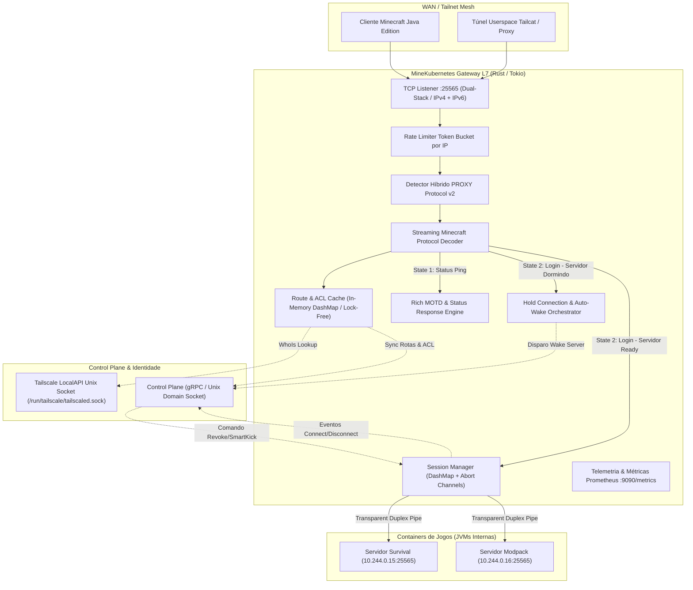
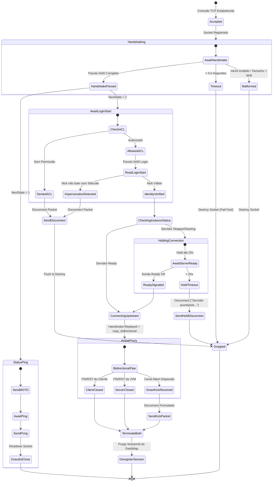
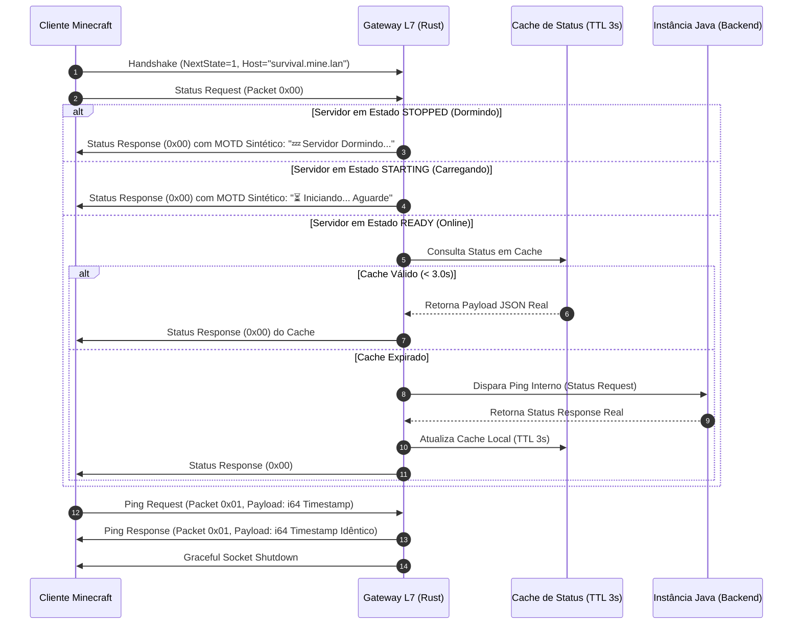
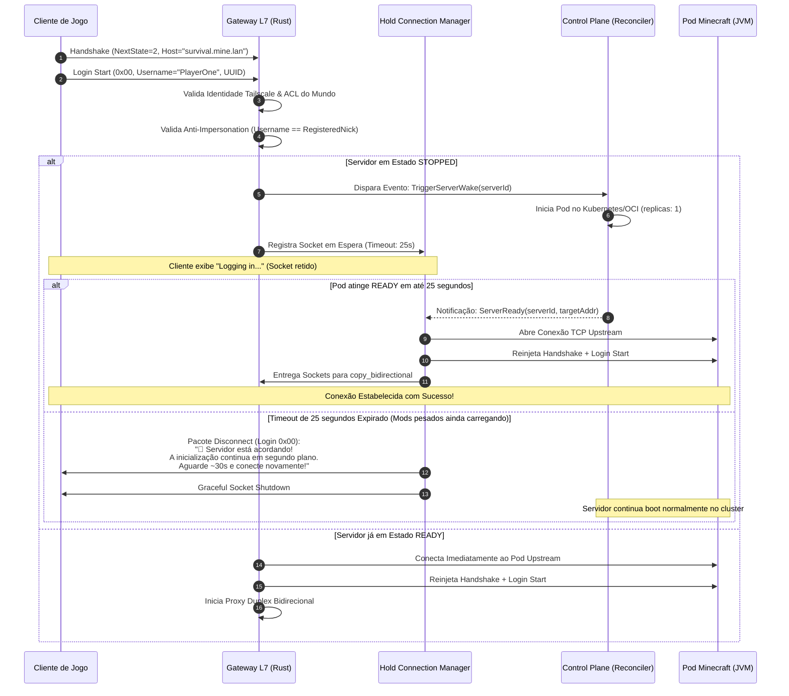
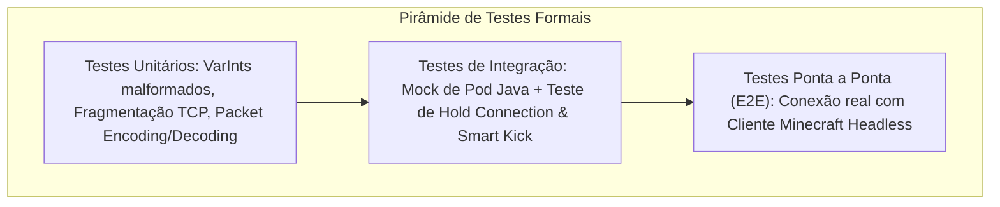

# Especificação de Requisitos de Software e Arquitetura de Sistemas (SRS)
## Módulo Gateway Reverso TCP L7 & Motor de Protocolo Minecraft (Rust / Tokio)

---

### Sumário Executivo e Metadados do Módulo
- **Projeto:** MineKubernetes — Next-Gen Game Server Hypervisor
- **Subsistema:** L7 Reverse TCP Gateway & Minecraft Protocol Streaming Engine
- **Linguagem & Runtime:** Rust (Edição 2021+), Tokio Runtime Multithreaded Assíncrono
- **Perfil do Documento:** Especificação Técnica Formal de Engenharia, Contratos Binários de Rede e Matriz de Implementação
- **Documentos Relacionados:**
  - [SRS-ARQUITETURA-HYPERVISOR.md](SRS-ARQUITETURA-HYPERVISOR.md) (Arquitetura Geral do Hypervisor)
  - [SRS-SUBSISTEMA-TAILSCALE.md](SRS-SUBSISTEMA-TAILSCALE.md) (Rede Mesh Tailscale & Identidade Zero-Trust)

---

## 1. Visão Geral e Princípios Arquiteturais

O **Gateway Reverso TCP L7** é o ponto focal de entrada de tráfego de rede do MineKubernetes. Ele escuta na porta padrão do Minecraft (`25565/TCP`) e conecta os clientes da Tailnet aos containers de jogos em execução no host, provendo virtual hosting baseado em subdomínios, controle de acesso Zero-Trust, gerenciamento dinâmico de presença e proteção contra impersonação.



### 1.1 Princípios de Design Obrigatórios
1. **Zero-GC e Consumo Mínimo de Recursos:** Desenvolvido em Rust compilado nativamente, operando sem pausas de Garbage Collector e com pegada de memória em repouso inferior a 30 MB de RAM.
2. **Zero-Allocation no Hot-Path:** Manipulação eficiente de fatias de memória e buffers contíguos reutilizáveis através da crate `bytes::BytesMut`, eliminando cópias redundantes durante decodificação de pacotes e proxying.
3. **Resiliência contra Fragmentação TCP:** O parser de protocolo é orientado a fluxo contínuo (streaming state machine), capaz de recompor pacotes cujos bytes cheguem particionados em múltiplos segmentos TCP ou concatenados em um único buffer.
4. **Isolamento de Falhas:** O encerramento abrupto, lentidão ou falha de uma conexão de cliente jamais bloqueia ou degrada o loop de eventos das demais conexões concorrentes.

---

## 2. Mecanismos de I/O Assíncrono e Modelo de Concorrência

### 2.1 Modelo de Concorrência Tokio
- O Gateway instancia um runtime multithreaded do Tokio (`tokio::runtime::Builder::new_multi_thread()`) ajustado para o número de cores disponíveis na máquina anfitriã.
- Para cada socket de cliente aceito pelo `tokio::net::TcpListener`, uma tarefa leve assíncrona (`tokio::task`) é instanciada para executar a máquina de estados inicial.
- As tarefas de proxy contínuo não utilizam threads de SO dedicadas; centenas de fluxos de dados concorrentes são multiplexados de forma orientada a eventos através de chamadas do sistema `epoll` (Linux) / `kqueue` (macOS).

### 2.2 Gerenciamento de Sessões e Prevenção de Socket Leaks
O vazamento de descritores de arquivo (File Descriptors - FDs) é eliminado por regras determinísticas de descarte:



#### Regras de Ouro de Ciclo de Vida do Socket:
1. **Destruição Mútua Obrigatória:** Se o socket upstream (lado JVM) fechar por qualquer razão (crash, shutdown, timeout), o socket do cliente deve ser forçosamente destruído (`client_stream.shutdown().await`), e vice-versa.
2. **Registro de Sessão com Canal de Abort:** Cada sessão ativa que transiciona para o estado `ActiveProxy` é registrada em um mapa concorrente `DashMap<SessionId, ActiveSessionHandle>`.
   ```rust
   pub struct ActiveSessionHandle {
       pub session_id: Uuid,
       pub client_ip: IpAddr,
       pub subdomain: String,
       pub minecraft_nick: String,
       pub connected_at: Instant,
       pub abort_sender: tokio::sync::oneshot::Sender<DisconnectReason>,
   }
   ```
3. **Smart Kick Interrompível:** O loop de transmissão utiliza `tokio::select!` entre a cópia bidirecional de bytes e o receptor `abort_receiver`. Se um evento de revogação de permissão for despachado pelo Control Plane, a cópia de dados é imediatamente abortada, o pacote de desconexão formatado é escrito no socket do cliente e ambos os sockets são fechados.

---

## 3. Decodificador e Motor de Protocolo Minecraft

O decodificador binário opera em camadas sobre fatias contíguas de bytes, implementando decodificação estrita das estruturas primitivas do protocolo oficial Minecraft.

### 3.1 Tipos Primitivos do Protocolo
| Tipo Primitivo | Codificação Binária | Limites / Regras de Validação |
| :--- | :--- | :--- |
| **VarInt** | Inteiro de tamanho variável de 1 a 5 bytes, codificado em 7 bits por byte (LEB128). O bit mais significativo (0x80) indica continuidade. | **Regra Estrita:** Se o 5º byte possuir o bit de continuidade ativo (`byte & 0x80 != 0`), o decodificador rejeita imediatamente a conexão como `MalformedVarInt`. |
| **VarLong** | Inteiro de tamanho variável de 1 a 10 bytes (LEB128). | Rejeitado se exceder 10 bytes. |
| **String UTF-8** | Sequência de caracteres UTF-8 prefixada por um VarInt indicando a contagem de bytes. | Limite estrito de 255 caracteres para nomes de host no Handshake; limite de 16 caracteres para nicknames no Login Start. |
| **Unsigned Short** | Inteiro de 16 bits sem sinal em Big-Endian (2 bytes). | Representa a porta de rede do servidor (`0` a `65535`). |
| **UUID** | Inteiro de 128 bits sem sinal (16 bytes brutos) ou String Canônica RFC 4122. | Presente nos pacotes modernos de Login Start (Minecraft 1.20.2+). |

### 3.2 Estrutura do Pacote Handshake (ID: `0x00`)
Enviado imediatamente pelo cliente ao abrir a conexão:

```
+------------------+------------------+-----------------------+---------------------+-------------------+------------------+
| Packet Length    | Packet ID        | Protocol Version      | Server Address      | Server Port       | Next State       |
| (VarInt, 1..5 B) | (VarInt: 0x00)   | (VarInt, e.g. 765)    | (String, VarInt+str)| (u16 Big-Endian)  | (VarInt: 1 ou 2) |
+------------------+------------------+-----------------------+---------------------+-------------------+------------------+
```

#### Higienização e Normalização do Hostname:
Launchers modificados (Minecraft Forge, NeoForge, FML, FML3, Lunar Client) anexam dados proprietários ao campo `Server Address` separados por caracteres nulos (`\0`).
- **Algoritmo de Normalização:**
  1. Localizar o primeiro byte nulo (`\0` ou `0x00`) na string decodificada. Se presente, truncar a string nesse índice.
  2. Remover qualquer porta anexada explicitamente no formato `:25565`.
  3. Remover pontos finais residuais (`.`) e converter integralmente para minúsculas (`to_ascii_lowercase`).
  4. Exemplo: `"SURVIVAL.mine.lan\0FML3\0:25565"` $\to$ `"survival.mine.lan"`.

### 3.3 Suporte Híbrido ao PROXY Protocol v2 (HAProxy)
Para viabilizar integração transparente com túneis de rede locais (como Tailcat em userspace) ou proxies reversos sem mascarar o IP de origem dos jogadores, o Gateway implementa **detecção não destrutiva da assinatura PROXY Protocol v2**.
- O Gateway inspeciona os primeiros 12 bytes da conexão:
  `\r\n\r\n\x00\r\nQUIT\n` (`0x0D, 0x0A, 0x0D, 0x0A, 0x00, 0x0D, 0x0A, 0x51, 0x55, 0x49, 0x54, 0x0A`).
- **Se presente:** Decodifica o cabeçalho binário v2, extrai o endereço IP real de origem do cliente (`src_addr`), consome os bytes do cabeçalho e prossegue para a decodificação do Handshake do Minecraft.
- **Se ausente:** O Gateway assume conexão TCP direta nativa e utiliza o endereço do próprio socket (`peer_addr().ip()`).

---

## 4. Virtual Hosting, Roteamento L7 e Políticas de Conexão

### 4.1 Tabela de Rotas em Memória (Zero-Allocation Hot-Path)
O Gateway mantém uma estrutura sincronizada em memória via canal IPC contínuo com o Control Plane:

```rust
pub struct RouteTable {
    /// Mapeamento de subdomínio normalizado -> Metadados do Servidor
    pub routes: DashMap<String, CachedServerRoute>,
    /// Identificador do servidor configurado como Fallback / Default Lobby (se houver)
    pub default_server: ArcSwapOption<String>,
}

pub struct CachedServerRoute {
    pub server_id: String,
    pub name: String,
    pub subdomain: String,
    pub target_addr: Option<UpstreamAddr>, // host:porta (IP ou hostname, resolvido a cada conexão); None se dormente (replicas=0)
    pub status: ServerInstanceStatus,    // Stopped, Starting, Ready, Crashed
    pub access_policy: AccessPolicy,     // Public, Group, Individual, Maintenance
    pub allowed_group_ids: HashSet<String>,
    pub allowed_user_ids: HashSet<String>,
    pub proxy_protocol_upstream: bool,   // Injetar PROXY v2 na JVM interna
    pub motd_config: Option<MotdConfig>, // Configuração de MOTD customizada
    pub max_players: u32,
    pub protocol_version: i32,
}
```

### 4.2 Resolução de Identidade Zero-Trust via Tailscale LocalAPI
Ao receber o IP de origem do cliente (ex.: `100.64.0.14`), o Gateway resolve a identidade do usuário consultando o daemon Tailscale local através de seu Unix Domain Socket (`/run/tailscale/tailscaled.sock`):
1. **Chamada LocalAPI WhoIs:**
   `GET /localapi/v0/whois?addr=100.64.0.14:port` sobre o socket Unix.
2. **Retorno Estruturado:**
   Extração do identificador do usuário (`UserProfile.ID`), Login Name e Tags associadas ao nó (`tag:player-<id>`).
3. **Cache em Memória Local:**
   O mapeamento `ClientIP -> Identity` é retido em um cache TTL de 60 segundos com invalidação sob demanda, garantindo que consultas repetidas de ping ou conexões frequentes não sobrecarreguem o socket do daemon.

---

## 5. Server List Ping e Rich MOTD Dinâmico

Quando um jogador adiciona o servidor à lista de multijogador ou pressiona o botão de atualizar (*Refresh*), o cliente executa o ciclo de **Server List Ping** (`NextState = 1`). O Gateway é capaz de fornecer respostas ricas, informativas e coloridas instantaneamente sem interagir com a JVM do servidor caso este esteja em modo dormente.



### 5.1 Especificação do Esquema JSON de Resposta de Status
O payload do pacote de Status Response (`0x00`) é uma string UTF-8 codificada em JSON estrito:

```json
{
  "version": {
    "name": "§aMineKubernetes §7[1.20.x]",
    "protocol": 765
  },
  "players": {
    "max": 20,
    "online": 0,
    "sample": [
      {
        "name": "§7[Clique para Conectar e Acordar]",
        "id": "00000000-0000-0000-0000-000000000000"
      }
    ]
  },
  "description": {
    "text": "§8[§c💤 HIBERNANDO§8] §fSurvival World\n§e⚡ Conecte para acordar a instância automaticamente!"
  },
  "favicon": "data:image/png;base64,iVBORw0KGgoAAAANSUhEUgAAAEAAAABACAYAAACqaXHe...",
  "enforcesSecureChat": false
}
```

### 5.2 Formatação Visual Dinâmica de Acordo com o Ciclo de Vida
| Estado da Instância | MOTD Exibido na Lista de Servidores | Contagem de Jogadores | Ícone de Conexão |
| :--- | :--- | :--- | :--- |
| **`Stopped` (Hibernando)** | `§8[§c💤 HIBERNANDO§8] §f<NomeServidor>\n§7Clique duas vezes para acordar o servidor.` | `0 / <MaxPlayers>` | Ícone com opacidade reduzida ou símbolo de sono |
| **`Starting` (Booting)** | `§8[§e⏳ INICIANDO...§8] §f<NomeServidor>\n§6Carregando chunks e mods. Aguarde alguns instantes...` | `0 / <MaxPlayers>` | Ícone padrão de loading |
| **`Ready` (Online)** | MOTD real configurado na instância (`server.properties` ou plugin). | Jogadores reais ativos via Gateway. | Ícone oficial do servidor |
| **`Maintenance`** | `§8[§4⛔ MANUTENÇÃO§8] §cServidor Temporariamente Fechado\n§7Apenas operadores autorizados podem acessar.` | `0 / 0` | Ícone de manutenção |
| **`Desconhecido / 404`** | `§c❌ Servidor não encontrado no MineKubernetes.\n§7Verifique o subdomínio ou contate o administrador.` | `0 / 0` | Sem favicon / Cruz vermelha |

---

## 6. Ciclo de Login, Auto-Wake e Retenção de Socket (Hold Connection)

Quando o jogador clica para conectar, o cliente inicia a fase de **Login** (`NextState = 2`).



### 6.1 Detalhes da Retenção de Socket (Hold Connection)
1. **Pausa de Leitura (Backpressure):** Durante a retenção de até 25 segundos, o socket do cliente não lê novos dados além do pacote `Login Start`, impedindo que buffers internos saturem a memória da tarefa.
2. **Desacoplamento do Ciclo de Boot:** Se o jogador perder a paciência e fechar o Minecraft durante os 25 segundos, o socket é destruído localmente, mas o comando de inicialização despachado para o Control Plane **permanece ativo**, garantindo que a JVM termine seu carregamento completo de spawn chunks.
3. **Mensagem Formatada de Disconnect:** Se a JVM demorar mais de 25 segundos para ficar pronta (comum em modpacks Forge com mais de 200 mods que demoram 60 a 90 segundos), o Gateway intercepta o timeout e despacha o pacote de desconexão formatado em JSON estruturado com quebras de linha e cores:
   ```json
   {
     "text": "🚀 §e§lMineKubernetes — Servidor em Inicialização!\n\n§fEste servidor estava hibernando para economizar recursos e §afoi acordado agora§f.\n§7A inicialização continua sendo processada em segundo plano no cluster.\n\n§6Por favor, aguarde cerca de 30 a 60 segundos e tente reconectar!",
     "color": "gold"
   }
   ```

### 6.2 Repasse Upstream e Injeção Opcional de PROXY Protocol v2
Ao estabelecer o socket de encaminhamento para a porta interna do container Minecraft (`10.244.x.y:25565`):
- **Modo Padrão (`proxy_protocol_upstream = false`):** O Gateway escreve exatamente o buffer binário armazenado contendo o pacote de Handshake original e o pacote de Login Start original, seguido imediatamente pelo início do pipe bidirecional.
- **Modo PROXY Protocol v2 (`proxy_protocol_upstream = true`):**
  1. O Gateway sintetiza o cabeçalho binário padrão HAProxy v2:
     - Preâmbulo fixo de 12 bytes.
     - Versão e Comando (`0x21` = Versão 2, Comando PROXY).
     - Família de Protocolo (`0x11` para IPv4 TCP ou `0x21` para IPv6 TCP).
     - Endereço IP de origem real do jogador (extraído da Tailnet/Tailcat).
     - Endereço IP de destino do Gateway.
     - Porta de origem do jogador e porta de destino `25565`.
  2. Escreve o cabeçalho PROXY v2 no socket upstream.
  3. Escreve o Handshake e Login Start originais.
  4. Inicia o pipe bidirecional.
  *Resultado:* Servidores Paper/Purpur com `proxy-protocol: true` registram o IP real da VPN nos logs de console e listas de banimento nativas (`/ban-ip`).

---

## 7. Matriz de Ameaças, Criptografia e Blindagem Defensiva

### 7.1 Análise Criptográfica: Modelo Híbrido vs. Criptografia Mojang
No protocolo oficial do Minecraft Java (`online-mode=true`):
1. O servidor envia um pacote `Encryption Request (0x01)` com chave pública RSA-1024 e token de verificação.
2. O cliente gera um segredo compartilhado AES-128, criptografa-o com a chave RSA e contata a Mojang (`sessionserver.mojang.com`).
3. O servidor valida a posse da conta junto à Mojang e, a partir desse instante, **todo o fluxo TCP é cifrado simetricamente via AES/CFB8**.

#### A Peculiaridade do Modo Híbrido no MineKubernetes:
- Para viabilizar suporte simultâneo a contas oficiais e clientes alternativos sem DRM, as instâncias operam com `online-mode=false`.
- Em modo offline, o handshake de criptografia nativo da Mojang **não é executado**. Os pacotes TCP Minecraft trafegariam em texto claro se expostos na Internet pública.
- **Camada Criptográfica Efetiva:** A confidencialidade e a integridade de ponta a ponta são garantidas integralmente pela **camada de transporte de rede Zero-Trust (Tailscale WireGuard - ChaCha20-Poly1305)**. Nenhum tráfego transita descriptografado fora da malha privada.
- **Assinaturas de Chat (Minecraft 1.19+):** As chaves de assinatura de chat enviadas no `Login Start` são tratadas de forma permissiva pelo Gateway, e as instâncias Paper/Purpur são configuradas com `enforce-secure-chat: false` para evitar kicks indevidos por falhas de atestação de chaves offline.

### 7.2 Fronteira de Confiança do PROXY Protocol v2 (Prevenção de IP Spoofing)
O suporte ao cabeçalho PROXY Protocol v2 introduz um vetor crítico de segurança se não for rigidamente controlado:
- **Vetor de Ataque:** Um invasor conectado à Tailnet envia bytes simulando o preâmbulo do PROXY v2 declarando o IP de um administrador (`100.64.0.1`), tentando enganar o Gateway para obter bypass de ACL.
- **Regra de Blindagem Defensiva (Trusted Proxies):**
  - O Gateway só aceita e interpreta cabeçalhos PROXY Protocol v2 se o socket de origem física (`peer_addr().ip()`) pertencer à lista explícita de **Endereços de Confiança (Trusted Proxies)**, configurável via variável de ambiente `TRUSTED_PROXY_IPS` (padrão: `127.0.0.1`, `::1` e sub-redes internas do cluster onde executam listeners como o Tailcat).
  - Se um pacote vindo de qualquer outro IP (incluindo IPs da Tailnet `100.x.y.z`) contiver a assinatura do PROXY Protocol v2, o pacote é sumariamente rejeitado ou o cabeçalho forjado é ignorado.

### 7.3 Sanitização Estrita de Strings e Prevenção de Injeção
Para prevenir explorações de buffer overflow, injeção de comandos e corrupção de sistema de arquivos:
1. **Validação de Hostname (Handshake):**
   - Truncamento imediato no primeiro caractere nulo (`\0`).
   - Remoção de portas residuais (`:25565`).
   - Validação estrita via expressão regular: `^[a-zA-Z0-9.-]{1,255}$`.
   - Conversão obrigatória para minúsculas (`to_ascii_lowercase`).
2. **Validação de Username (Login Start):**
   - O nickname declarado deve aderir estritamente ao padrão do Minecraft Vanilla: `^[a-zA-Z0-9_]{2,16}$`.
   - Nomes contendo caracteres de escape ANSI, espaços, caracteres de controle UTF-8 ou quebras de linha (`\r\n`) são rejeitados imediatamente no nível binário antes de tocar o banco de dados.
3. **Prevenção de VarInt Bombs:**
   - O leitor de VarInt lança erro fatal se o 5º byte mantiver o bit de continuidade `0x80` ativo, descartando o socket em tempo $O(1)$ sem alocações no heap.

### 7.4 Gestão de Conflito de Sessões Concorrentes (Anti-Cloning)
Se um jogador tentar abrir uma nova sessão enquanto outra conexão com o mesmo nickname já estiver ativa:
- **Política de Despejo da Sessão Antiga (Eviction):** O Gateway localiza a sessão prévia no `DashMap<SessionId, ActiveSessionHandle>`, aciona o canal `abort_sender` transmitindo o pacote formatado `Disconnect: "§cSua conta conectou a partir de outro dispositivo ou local."`, fecha os sockets da sessão antiga e concede a entrada para a nova conexão. Isso elimina estados fantasmas (*ghost players*) na JVM e previne clonagem de inventários.

### 7.5 Matriz de Proteções contra DoS e Esgotamento de Recursos

| Vetor de Ameaça | Impacto Potencial | Mecanismo de Defesa do Gateway L7 |
| :--- | :--- | :--- |
| **Slowloris / Conexões Pendentes** | Esgotamento de descritores de arquivo (FDs) abrindo conexões sem enviar bytes. | **Timeout Estrito de 5.0 Segundos:** Se o socket não completar o Handshake e Login Start em 5s, a conexão é destruída imediatamente. Adicionalmente, `SO_KEEPALIVE` curto (15s) detecta conexões mortas sem FIN. |
| **VarInt Bomb / Overflows** | Estouro de buffer tentando decodificar VarInt malicioso de tamanho infinito. | **Teto de 5 Bytes:** O leitor de VarInt lança erro fatal se o 5º byte contiver `0x80`. |
| **String / Memory Bomb** | Envio de string declarando 2 GB de tamanho forçando alocação de memória no heap. | **Teto de 4096 Bytes por Pacote:** Qualquer pacote pré-login que declare tamanho superior a 4 KB é abortado na hora sem alocação de buffer. |
| **Connection Flooding** | Scanners automatizados abrindo dezenas de conexões por segundo de um mesmo nó da Tailnet. | **Token Bucket Rate Limiter (Crate `governor`):** Limite configurável de rajada (ex.: max 10 conexões/segundo por IP de origem). Excedentes são descartados silenciosamente com TCP RST. |
| **Socket / FD Leak** | Clientes encerram a conexão de forma abrupta sem handshake TCP FIN. | **Tratamento Simétrico de Erros:** O drop de um lado do pipe dispara `shutdown()` forçado imediato no socket oposto e remoção atômica do mapa de sessões em memória. |

---

## 8. Contratos de IPC com o Control Plane (gRPC / Unix Socket)

A comunicação entre o Control Plane (orquestrador principal) e o Gateway de Tráfego L7 opera de forma bidirecional via gRPC ou Unix Domain Socket através de schemas de Protocol Buffers (`.proto`):

```protobuf
syntax = "proto3";
package minekubernetes.gateway.v1;

service GatewayControlService {
  // Streaming contínuo: Control Plane envia mutações de rotas e políticas para o Gateway
  rpc StreamRouteUpdates (Empty) returns (stream RouteUpdateEvent);

  // Streaming contínuo: Gateway despacha eventos de conexão, desconexão e métricas
  rpc StreamSessionEvents (stream SessionLifecycleEvent) returns (Empty);

  // Comando RPC pontual: Control Plane solicita expulsão imediata de jogador (Smart Kick)
  rpc RevokePlayerSession (RevokeSessionRequest) returns (RevokeSessionResponse);

  // Sincronização inicial: Gateway busca snapshot completo de todas as rotas no boot
  rpc GetInitialRoutingSnapshot (Empty) returns (RoutingSnapshotResponse);
}

message RouteUpdateEvent {
  enum Action {
    UPSERT = 0;
    DELETE = 1;
    STATUS_CHANGE = 2;
  }
  Action action = 1;
  string server_id = 2;
  string subdomain = 3;
  string target_ip_port = 4;
  string status = 5; // STOPPED, STARTING, READY, MAINTENANCE
  string access_policy = 6;
  repeated string allowed_group_ids = 7;
  repeated string allowed_user_ids = 8;
  bool proxy_protocol = 9;
}

message SessionLifecycleEvent {
  enum EventType {
    CONNECTED = 0;
    DISCONNECTED = 1;
    WAKE_REQUESTED = 2;
    ACCESS_DENIED = 3;
  }
  EventType event_type = 1;
  string session_id = 2;
  string server_id = 3;
  string client_ip = 4;
  string minecraft_nick = 5;
  int64 timestamp_epoch_ms = 6;
  string reason = 7;
}

message RevokeSessionRequest {
  string server_id = 1;
  string client_ip = 2;
  string reason_message = 3;
}

message RevokeSessionResponse {
  bool session_found = 1;
  int32 terminated_connections_count = 2;
}

message Empty {}
```

---

## 9. Telemetria, Métricas e Observabilidade

O Gateway expõe um servidor HTTP interno secundário escutando na porta `9090` disponibilizando:
- Endpoint `/metrics` para raspagem pelo Prometheus.
- Endpoint `/healthz` respondendo `200 OK` quando o listener TCP da porta 25565 e os canais IPC estiverem saudáveis.

### 9.1 Catálogo de Métricas Prometheus
```prometheus
# HELP minecraft_gateway_active_sessions_total Número de sessões TCP atualmente ativas no proxy
# TYPE minecraft_gateway_active_sessions_total gauge
minecraft_gateway_active_sessions_total{server_id="srv-123",subdomain="survival.mine.lan"} 4

# HELP minecraft_gateway_connections_total Total acumulado de tentativas de conexão recebidas
# TYPE minecraft_gateway_connections_total counter
minecraft_gateway_connections_total{subdomain="survival.mine.lan",status="accepted"} 1420
minecraft_gateway_connections_total{subdomain="survival.mine.lan",status="denied_acl"} 12
minecraft_gateway_connections_total{subdomain="survival.mine.lan",status="denied_impersonation"} 3
minecraft_gateway_connections_total{subdomain="survival.mine.lan",status="wake_triggered"} 45

# HELP minecraft_gateway_bytes_transferred_total Total acumulado de bytes transferidos pelo proxy
# TYPE minecraft_gateway_bytes_transferred_total counter
minecraft_gateway_bytes_transferred_total{direction="rx",server_id="srv-123"} 158942100
minecraft_gateway_bytes_transferred_total{direction="tx",server_id="srv-123"} 842199340

# HELP minecraft_gateway_handshake_duration_seconds Latência de processamento do handshake e autorização
# TYPE minecraft_gateway_handshake_duration_seconds histogram
minecraft_gateway_handshake_duration_seconds_bucket{le="0.001"} 980
minecraft_gateway_handshake_duration_seconds_bucket{le="0.005"} 1410
minecraft_gateway_handshake_duration_seconds_bucket{le="0.010"} 1420
```

---

## 10. Estrutura do Workspace Cargo

O código do Gateway é organizado como um **Cargo Workspace** modular no diretório `crates/`:

```
crates/
├── minecraft-protocol/              # Crate de biblioteca pura (Zero-I/O)
│   ├── Cargo.toml
│   └── src/
│       ├── lib.rs                   # Re-exports públicos
│       ├── types/
│       │   ├── mod.rs
│       │   ├── varint.rs            # Decodificador e codificador LEB128
│       │   ├── varlong.rs
│       │   ├── string.rs            # Strings UTF-8 delimitadas
│       │   └── chat_component.rs    # Formatadores JSON de mensagens / cores
│       ├── packets/
│       │   ├── mod.rs
│       │   ├── handshake.rs         # Packet 0x00 Handshake
│       │   ├── status.rs            # Status Request (0x00) & Status Response (0x00)
│       │   ├── ping.rs              # Ping Request (0x01) & Ping Response (0x01)
│       │   ├── login_start.rs       # Login Start (0x00)
│       │   └── disconnect.rs        # Disconnect (Login 0x00 / Play 0x1A)
│       ├── proxy_protocol.rs        # Parser e Serializador HAProxy PROXY Protocol v2
│       └── codec.rs                 # Implementação de Decoder/Encoder para tokio_util
│
└── gateway/                         # Crate de binário executável do serviço
    ├── Cargo.toml
    └── src/
        ├── main.rs                  # Ponto de entrada, inicialização de runtime e signals
        ├── config.rs                # Variáveis de ambiente e configuração
        ├── server.rs                # TCP Listener Loop na porta 25565
        ├── connection.rs            # Ciclo de vida e máquina de estados da conexão
        ├── routing/
        │   ├── mod.rs
        │   ├── table.rs             # DashMap de rotas em memória
        │   └── resolver.rs          # Resolução de domínio, fallback e normalização
        ├── identity/
        │   ├── mod.rs
        │   ├── tailscale_local.rs   # Driver de Unix Socket WhoIs da Tailscale
        │   └── acl_engine.rs        # Validador de grupos, nominais e anti-impersonation
        ├── motd/
        │   ├── mod.rs
        │   ├── synthetic.rs         # Gerador de MOTD dinâmico (Dormindo / Iniciando)
        │   └── cache.rs             # Cache com TTL de 3s para servidores online
        ├── hold/
        │   ├── mod.rs
        │   └── manager.rs           # Hold connection e temporizador de Auto-Wake
        ├── session/
        │   ├── mod.rs
        │   └── manager.rs           # Gerenciamento de sessões ativas e Smart Kick
        ├── ipc/
        │   ├── mod.rs
        │   └── client.rs            # Cliente gRPC para sincronização com Control Plane
        └── telemetry/
            ├── mod.rs
            ├── metrics.rs           # Exporter Prometheus (:9090/metrics)
            └── tracing_init.rs      # Setup do tracing-subscriber (JSON / console)
```

---

## 11. Matriz de Testes Formais

A qualidade e robustez do Gateway são asseguradas por uma pirâmide formal de testes:



### 11.1 Casos de Teste Unitários Críticos (`minecraft-protocol`)
1. **`test_varint_valid_boundaries`:** Testa valores nos limites de 1 a 5 bytes (`0`, `127`, `128`, `255`, `2147483647`).
2. **`test_varint_overflow_rejection`:** Submete sequência de 5 bytes com `0x80` ativo e valida se retorna erro imediato sem consumir memória.
3. **`test_handshake_hostname_sanitization`:** Testa entradas com extensões de modpack como `"test.domain.com\0FML\0"`, `"TEST.DOMAIN.COM:25565"` e garante saída normalizada `"test.domain.com"`.
4. **`test_proxy_protocol_v2_detection`:** Valida que preâmbulos válidos de PROXY v2 são detectados e preâmbulos corrompidos são rejeitados com segurança.

### 11.2 Casos de Teste de Integração Assíncronos (`gateway`)
1. **`test_tcp_fragmentation_tolerance`:** Envia o pacote de Handshake fatiado em pedaços de 1 byte com intervalos assíncronos (`tokio::time::sleep`), garantindo que o buffer recomponha o pacote sem erros.
2. **`test_hold_connection_timeout_and_disconnect`:** Simula um servidor dormindo que não responde a tempo; valida se exatamente aos 25 segundos o cliente recebe o pacote `Disconnect (0x00)` formatado e a conexão encerra.
3. **`test_smart_kick_execution`:** Inicia sessão de proxy ativa entre cliente falso e servidor mock; dispara sinal de revogação e valida se o socket do cliente recebe o pacote de kick e ambos os lados fecham em menos de 10 milissegundos.

---

## 12. Roadmap de Implementação por Fases

| Fase | Entregável Principal | Critérios de Aceite |
| :--- | :--- | :--- |
| **Fase 1** | Crate `minecraft-protocol` | Parser completo de VarInt, String, Handshake, Status, Ping, Login Start e Disconnect com 100% de cobertura de testes unitários. |
| **Fase 2** | TCP Server & Server List Ping | Listener Tokio na porta 25565 respondendo Status Request / Ping com MOTD sintético dinâmico e suporte a PROXY Protocol v2. |
| **Fase 3** | Proxy Duplex & Upstream Replay | Conexão transparente via `copy_bidirectional`, reinjeção de Handshake/Login Start e injeção opcional de cabeçalho PROXY v2. |
| **Fase 4** | Identidade Tailscale, ACL & Anti-Impersonation | Integração com Unix Socket WhoIs da Tailscale, validação de regras de grupos e bloqueio de nomes de usuário não autorizados. |
| **Fase 5** | Hold Connection, Auto-Wake & Smart Kick | Retenção de conexões para instâncias dormindo com timeout de 25s, canal de cancelamento imediato para expulsão e telemetria Prometheus. |
