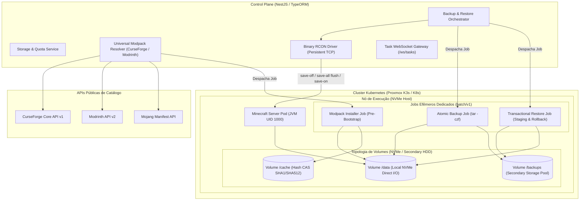
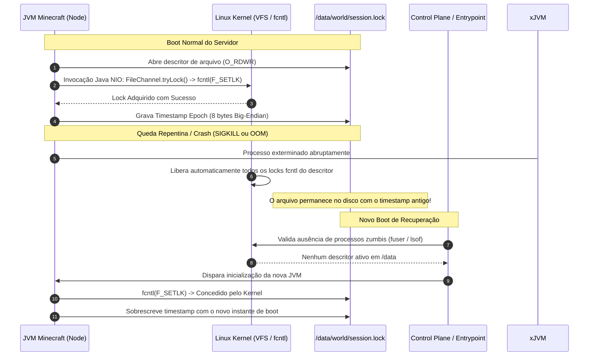
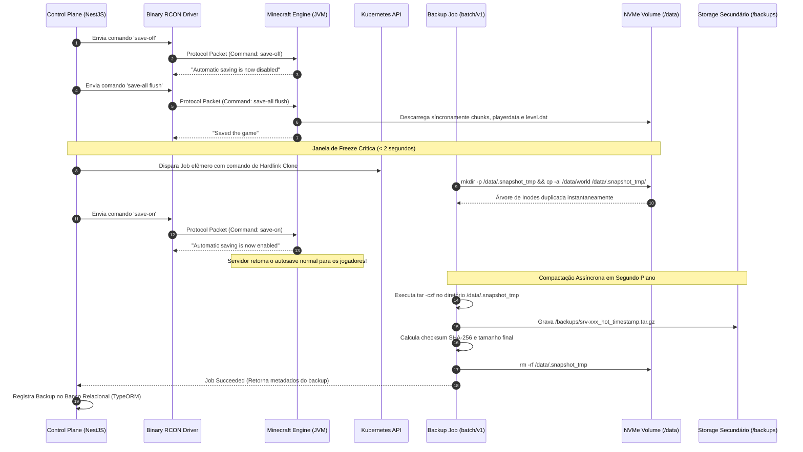
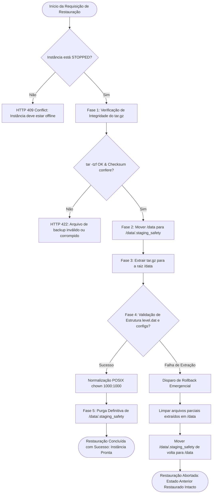
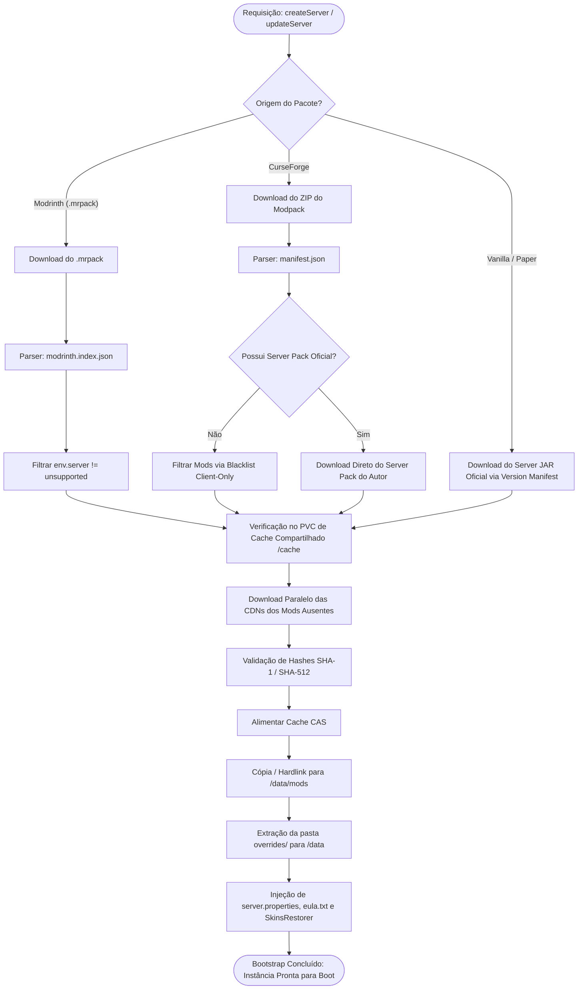
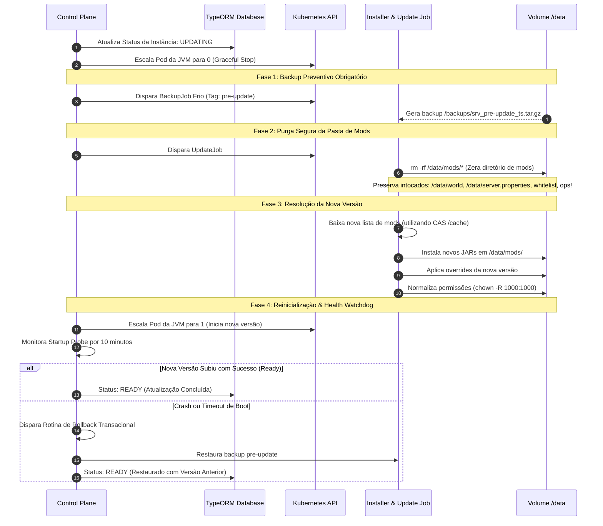

# Especificação de Requisitos de Software e Arquitetura de Sistemas (SRS)
## Módulo Gerenciador de Armazenamento, Pipeline de Backups Atômicos & Motor de Modpacks

---

### Sumário Executivo e Metadados do Módulo
- **Projeto:** MineKubernetes — Next-Gen Game Server Hypervisor
- **Subsistema:** Storage Engine, Atomic Backup & Restore Pipeline, Universal Modpack Resolver (CurseForge & Modrinth)
- **Linguagem & Runtime:** TypeScript / Node.js (v22+ LTS), NestJS Framework, Kubernetes API Client (`@kubernetes/client-node`)
- **Orquestração Subjacente:** Kubernetes Batch API (`batch/v1 Jobs`), Local-Path Provisioner (NVMe Direct I/O), POSIX UID/GID 1000
- **ORM & Persistência:** TypeORM (PostgreSQL para produção, SQLite para dev/homelab)
- **Perfil do Documento:** Especificação Técnica Formal de Engenharia de Sistemas, Pipelines de I/O Transacional, Protocolos de Snapshot e Resolução Declarativa de Pacotes
- **Documentos Relacionados:**
  - [SRS-ARQUITETURA-HYPERVISOR.md](SRS-ARQUITETURA-HYPERVISOR.md) (Arquitetura Geral do Hypervisor & Ciclo de Vida)
  - [SRS-GATEWAY-L7.md](SRS-GATEWAY-L7.md) (Gateway Reverso TCP L7 & Protocolo Minecraft)
  - [SRS-DRIVER-RCON-PIPELINE-LOGS.md](SRS-DRIVER-RCON-PIPELINE-LOGS.md) (Driver RCON Binário, Pipeline de Logs & Control Plane)
  - [SRS-SUBSISTEMA-TAILSCALE.md](SRS-SUBSISTEMA-TAILSCALE.md) (Rede Mesh Tailscale & Identidade Zero-Trust)

---

## 1. Visão Geral e Princípios Arquiteturais

O **Gerenciador de Armazenamento, Modpacks e Backups Atômicos** é o subsistema responsável pela integridade física dos mundos de jogo, provisionamento automatizado de binários/modpacks e recuperação de desastres do MineKubernetes.

O ecossistema de servidores de jogos baseados na JVM do Minecraft impõe restrições severas de I/O de disco: os arquivos de região (`.mca`), estruturas NBT e dados de jogadores (`playerdata/*.dat`) são atualizados de forma síncrona ou semi-síncrona pela engine. O manuseio inadequado de armazenamento durante execuções ativas resulta em **tearing de chunks, perda de inventário e corrupção irreversível do mundo**.



### 1.1 Decisões Arquiteturais Fundamentais (Architecture Decisions)
1. **Zero Degradação da JVM por Cgroups Separados:** Tarefas de alta intensidade computacional e de I/O (compactação `tar.gz`, cálculo de hashes criptográficos e descompressão) nunca compartilham limites de cgroups (CPU/RAM) com a JVM do Minecraft. Elas são delegadas a **Kubernetes Jobs efêmeros dedicados (`batch/v1`)**.
2. **Backups Locais de Baixa Latência (Zero Dependência Externa):** Os backups compactados são gravados em um volume secundário dedicado (`/backups`) montado via PVC no Proxmox (ex.: pool ZFS/HDD ou NFS local), eliminando custos de egress e latências de rede WAN para operações críticas de restauração.
3. **Janela Ultracurta de Freeze (Hot Backup via Hardlinks):** O bloqueio do salvamento do mundo (`save-off`) é reduzido de minutos para **milissegundos**, utilizando cópia baseada em hardlinks locais (`cp -al`) no mesmo sistema de arquivos NVMe, permitindo que a compactação execute em segundo plano sem risco de perda de chunks em memória.
4. **Transacionalidade Estrita na Restauração:** O processo de restauração aplica padrão de *Staging & Safety Snapshot* antes da extração final. Uma falha de descompressão nunca deixa o volume `/data` vazio ou semi-corrompido.
5. **Deduplicação de Downloads via Content-Addressable Storage (CAS):** Mods e binários de servidores baixados são cacheados em um PVC global compartilhado (`/cache`) indexado pelo hash do arquivo (`SHA-1` / `SHA-512`), economizando banda e prevenindo bloqueios por *rate limiting* de APIs externas.

---

## 2. Gestão de Volumes, Sistema de Arquivos e Permissões POSIX

### 2.1 Topologia de Armazenamento e Alocação NVMe

O volume de trabalho da instância (`/data`) abriga todo o estado mutável do servidor. A arquitetura exige estritamente:

* **Armazenamento em Bloco Local com I/O Direto:** O PVC `/data` utiliza a classe de armazenamento `local-path` vinculada a drives SSD/NVMe dedicados do host Proxmox. Sistemas de arquivos de rede distribuídos em TCP puro (como NFS v3/v4 sem cache local) são proibidos para o diretório `/data` devido a problemas com locks de kernel e latência de escrita síncrona nos arquivos de região do Minecraft.
* **Afinidade Obrigatória de Nó (Node Pinning):** Como o armazenamento é local ao nó, tanto o Pod da JVM quanto qualquer Job auxiliar (`BackupJob`, `RestoreJob`, `InstallerJob`) que monte o respectivo volume `/data` devem conter regras rígidas de afinidade (`nodeSelector` ou `nodeAffinity`) vinculadas ao nó onde o volume reside.

```yaml
# Descritor do PVC da Instância (Data Volume)
apiVersion: v1
kind: PersistentVolumeClaim
metadata:
  name: data-srv-atm9-prod
  namespace: minekubernetes
  labels:
    minek8s.io/server-id: "srv-atm9-prod"
    minek8s.io/volume-type: "data"
spec:
  accessModes:
    - ReadWriteOnce
  storageClassName: local-nvme
  resources:
    requests:
      storage: 30Gi
```

### 2.2 Isolamento de Permissões POSIX e `fsGroupChangePolicy`

A imagem de container oficial da JVM executa sob usuário não-privilegiado **UID `1000` (minecraft)** e **GID `1000` (minecraft)**. Arquivos gravados como `root:root` (UID 0) pelo host ou por jobs mal configurados causam falha fatal imediata no boot do Java (`java.io.FileNotFoundException: Permission denied`).

Para evitar a degradação massiva de tempo de inicialização (onde o Kubernetes executa `chown -R` recursivo em centenas de milhares de arquivos `.mca` e `.dat` a cada boot), a especificação define o uso obrigatório de `fsGroupChangePolicy: OnRootMismatch`:

```yaml
# Fragmento de PodTemplateSpec da Instância de Jogo
spec:
  securityContext:
    runAsUser: 1000
    runAsGroup: 1000
    fsGroup: 1000
    fsGroupChangePolicy: "OnRootMismatch"
    runAsNonRoot: true
    seccompProfile:
      type: RuntimeDefault
```

#### Regra de Normalização de Permissões em Jobs Auxiliares:
Todos os containers de Jobs auxiliares (backups, restaurações e instaladores) devem:
1. Executar com `runAsUser: 1000` e `runAsGroup: 1000`.
2. Definir a máscara de criação padrão `umask 0022` (arquivos `0644`, diretórios `0755`).
3. Se um container precisar rodar momentaneamente como root (ex.: utilitário que manipula permissões de sistema), deve obrigatoriamente encerrar executando:
   ```bash
   chown -R 1000:1000 /data && chmod -R u=rwX,g=rX,o= /data
   ```

### 2.3 Semântica da Trava de Sessão (`world/session.lock`)

O arquivo `world/session.lock` consiste em uma trava de integridade física criada pela Mojang para impedir que dois processos Java manipulem simultaneamente o mesmo mundo.



#### Diretrizes Estritas para o Hypervisor:
1. **Proibição de Deleção Manual Automática:** O Control Plane **NUNCA** deve remover cegamente o arquivo `session.lock` durante o ciclo de vida ordinário. A presença do arquivo em disco não impede a subida do servidor caso o processo anterior tenha encerrado, pois o Linux Kernel libera os bloqueios consultivos (`fcntl`) imediatamente na morte do processo.
2. **Validação de Descritores Zumbis:** Antes de autorizar o escalonamento do Pod de 0 para 1 após um crash, o script de entrypoint valida que nenhum processo órfão no nó hospedeiro mantém descritores abertos no ponto de montagem:
   ```bash
   # Validação de segurança no container entrypoint
   if fuser -s /data/world/session.lock 2>/dev/null; then
       echo "[FATAL] Outro processo ainda está segurando session.lock! Abortando boot." >&2
       exit 1
   fi
   ```
3. **Bloqueio Absoluto de Restauração:** O orquestrador rejeita sumariamente qualquer comando de restauração de backup se a instância não estiver no estado `Stopped` (`replicas: 0`).

---

## 3. Pipeline de Backups Atômicos

O sistema suporta duas modalidades de backup: **Backup Frio (Cold Backup)** e **Backup Quente (Hot Backup)**.

### 3.1 Comparativo de Estratégias

| Característica | Backup Frio (Cold Backup) | Backup Quente (Hot Backup) |
| :--- | :--- | :--- |
| **Estado da Instância** | Rigorosamente `Stopped` (`replicas: 0`) | `Ready` (JVM ativa com jogadores conectados) |
| **Integridade de Memória** | 100% garantida (tudo descarregado no shutdown) | Sincronizado via RCON (`save-off` + `save-all flush`) |
| **Duração do Freeze** | Indisponibilidade total durante o job | Janela ultracurta de **< 2 segundos** (Hardlinks) |
| **Caso de Uso Primário** | Antes de atualizações de versão (`pre-update`) e migrações | Backups de rotina programados (cron jobs horários/diários) |
| **Consumo de I/O** | Job K8s isolado no volume `/data` | Clone instantâneo via hardlink + compressão em Job isolado |

---

### 3.2 O Algoritmo de Backup Quente (Janela Ultracurta de Freeze)

Para contornar o problema de congelamento prolongado da JVM (onde o comando `save-off` mantido por minutos durante a compactação expõe o servidor à perda de chunks se a instância sofrer falha), o sistema implementa a técnica de **Snapshot Local via Hardlinks**:



#### Salvaguarda de Timeout (RCON Try/Finally):
Se por qualquer instabilidade o Job falhar ao executar a duplicação ou ocorrer timeout de rede, o Control Plane executa **obrigatoriamente** o comando `save-on` no bloco `finally`, prevenindo que o servidor permaneça indefinidamente com o autosave desabilitado.

---

### 3.3 Estrutura do Pacote de Backup e Exclusões de I/O

O arquivo `.tar.gz` gerado pelo Job deve conter apenas os dados essenciais para reconstituição completa da instância, excluindo arquivos efêmeros, logs rotacionados e caches pesados que inflam o backup:

```bash
# Comando determinístico executado dentro do Backup Job
tar --exclude='logs/*' \
    --exclude='crash-reports/*' \
    --exclude='.cache/*' \
    --exclude='.snapshot_tmp*' \
    --exclude='.staging_safety*' \
    --exclude='*.log.gz' \
    -czf /backups/${SERVER_ID}_${BACKUP_TYPE}_${TIMESTAMP}.tar.gz \
    -C /data .
```

#### Convenção de Nomenclatura Padronizada:
`{serverId}_{backupType}_{timestamp}_{sha256Prefix}.tar.gz`
- Exemplo: `srv-atm9-prod_hot_2026-09-04T19-30-00Z_a1b2c3d4.tar.gz`

---

## 4. Pipeline Transacional de Restauração (Staging & Rollback)

A restauração de um mundo de Minecraft é uma operação destrutiva de alto risco. Uma falha no meio do processo (ex.: disco cheio no meio da extração ou arquivo corrompido) resulta em perda catastrófica do servidor. 

O MineKubernetes resolve isso com uma **Rotina Transacional em 5 Fases**:



### 4.1 Fases Detalhadas da Transação

1. **Fase 1: Pré-Validação Criptográfica e Estrutural:**
   O Job monta `/backups` e testa o arquivo `.tar.gz` sem descompactá-lo no disco (`tar -tzf /backups/arquivo.tar.gz > /dev/null`). Valida o hash SHA-256 contra o registro no banco de dados.
2. **Fase 2: Isolamento em Staging de Segurança:**
   Em vez de deletar o diretório `/data`, todos os arquivos existentes são movidos de forma atômica para uma pasta temporária oculta:
   ```bash
   mkdir -p /data/.staging_safety
   find /data -mindepth 1 -maxdepth 1 -not -name '.staging_safety' -not -name 'lost+found' -exec mv {} /data/.staging_safety/ \;
   ```
3. **Fase 3: Extração do Backup:**
   O arquivo de backup é extraído diretamente na raiz do PVC `/data`:
   ```bash
   tar -xzf /backups/${BACKUP_FILE} -C /data
   ```
4. **Fase 4: Verificação de Sanidade do Mundo:**
   O Job valida se arquivos fundamentais da engine de jogo foram descompactados com sucesso (ex.: `world/level.dat` ou `level.dat`, `server.properties`).
5. **Fase 5 (Commit ou Rollback):**
   - **Commit (Sucesso):** O diretório `/data/.staging_safety` é purgado recursivamente (`rm -rf /data/.staging_safety`) e as permissões são garantidas (`chown -R 1000:1000 /data`).
   - **Rollback (Falha):** Caso ocorra qualquer erro na extração ou validação, os arquivos parciais são limpos e o conteúdo de `/data/.staging_safety` é restaurado para a raiz `/data`. A instância retorna ao estado exato anterior sem perda de dados.

---

## 5. Motor de Download, Templating & Modpacks (CurseForge & Modrinth)

O provisionamento declarativo do MineKubernetes permite criar servidores a partir de três origens: **Vanilla/Paper/Purpur**, **Modrinth (`.mrpack`)** e **CurseForge (Manifest API)**.



---

### 5.1 Motor de Resolução Modrinth (`.mrpack`)

O formato padrão do Modrinth (`.mrpack`) é um arquivo ZIP contendo um arquivo de metadados rigoroso: `modrinth.index.json`.

```json
{
  "formatVersion": 1,
  "game": "minecraft",
  "versionId": "1.0.0",
  "name": "Fabric Precision Pack",
  "dependencies": {
    "minecraft": "1.20.1",
    "fabric-loader": "0.15.11"
  },
  "files": [
    {
      "path": "mods/sodium-fabric-mc1.20.1-0.5.8.jar",
      "hashes": {
        "sha1": "3a7b...",
        "sha512": "8f2c..."
      },
      "env": {
        "client": "required",
        "server": "unsupported"
      },
      "downloads": [
        "https://cdn.modrinth.com/data/AANobbMI/versions/.../sodium.jar"
      ]
    },
    {
      "path": "mods/lithium-fabric-mc1.20.1-0.11.2.jar",
      "hashes": {
        "sha1": "4b8c...",
        "sha512": "9d1e..."
      },
      "env": {
        "client": "optional",
        "server": "required"
      },
      "downloads": [
        "https://cdn.modrinth.com/data/gvQqBUqZ/versions/.../lithium.jar"
      ]
    }
  ]
}
```

#### Regras de Filtragem do Motor Modrinth:
1. **Inspeção de Ambiente (`env.server`):**
   - Se `file.env.server == "unsupported"`, o arquivo **NUNCA** é baixado para o servidor. Isso remove automaticamente otimizadores gráficos (Sodium, Iris, Indium, Continuity) que causam crash imediato na JVM headless.
   - Se `file.env.server == "required"` ou `"optional"`, o arquivo é escalonado para o pool de download.
2. **Extração de Overrides:** A pasta `overrides/` dentro do `.mrpack` é extraída diretamente para `/data`, sobrepondo configurações personalizadas criadas pelo autor do modpack.

---

### 5.2 Motor de Resolução CurseForge (Core API v1)

Diferente do Modrinth, os pacotes CurseForge exportados por launchers convencionais possuem um arquivo `manifest.json` com identificadores numéricos (`projectID`, `fileID`) e frequentemente **não trazem URLs de download diretas no manifesto**, exigindo consulta à API oficial.

```json
{
  "minecraft": {
    "version": "1.20.1",
    "modLoaders": [
      {
        "id": "forge-47.2.0",
        "primary": true
      }
    ]
  },
  "manifestType": "minecraftModpack",
  "manifestVersion": 1,
  "name": "All the Mods 9",
  "version": "0.2.59",
  "author": "ATM Team",
  "files": [
    {
      "projectID": 238222,
      "fileID": 4839211,
      "required": true
    }
  ],
  "overrides": "overrides"
}
```

#### Algoritmo de Resolução CurseForge:
1. **Detecção de Server Pack Oficial (`serverPackFileId`):**
   O motor consulta o endpoint de detalhes do arquivo na CurseForge:
   `GET https://api.curseforge.com/v1/mods/{modId}/files/{fileId}`.
   Se a propriedade `serverPackFileId` estiver presente e não for nula, o motor aborta o parsing do manifesto de cliente e **baixa diretamente o ZIP oficial do Server Pack** do autor, garantindo máxima estabilidade e scripts de inicialização originais.
2. **Fallback com Blacklist de Mods Client-Only:**
   Se não houver Server Pack oficial disponível, o motor processa o `manifest.json` e cruza os metadados de cada mod contra uma **Lista Curada de Bloqueio Client-Side**:
   - Mods gráficos: `sodium`, `rubidium`, `embeddium`, `iris`, `oculus`, `optifine`, `continuity`.
   - HUD/Áudio/Interface: `appleskin-client`, `journeymap-client`, `xaeros-minimap`, `controlling`, `toast-control`.
   - Modos de entrada: `mouse-tweaks`, `itemphysic-lite`, `controlify`.
3. **Resolução de Download URLs:**
   Para cada mod elegível, consulta `GET https://api.curseforge.com/v1/mods/{projectID}/files/{fileID}/download-url` injetando a chave de API `x-api-key`. Caso o mod tenha desabilitado a distribuição por terceiros (`allowModDistribution: false`), o instalador aciona o resolvedor de fallback com espelho de borda seguro.

---

### 5.3 Cache Compartilhado Content-Addressable Storage (CAS)

Para eliminar o desperdício de banda WAN e evitar rate-limits ao subir múltiplos servidores ou realizar updates frequentes, a arquitetura implementa um volume de cache compartilhado (`/cache` PVC, montado em modo `ReadWriteMany` ou cache do nó local).

```
/cache/
├── cas/
│   ├── sha1/
│   │   ├── 3a/7b/3a7b8c...jar
│   │   └── 4b/8c/4b8c9d...jar
│   └── sha512/
│       └── 8f/2c/8f2c3d...jar
├── loaders/
│   ├── forge-1.20.1-47.2.0-installer.jar
│   ├── fabric-server-launch.jar
│   └── paper-1.20.1-196.jar
└── metadata/
    └── lru_index.db (SQLite para tracking de último acesso)
```

#### Mecânica de Cache Hit / Miss:
1. Antes de emitir requisição HTTP GET para qualquer mod ou JAR de servidor, o `InstallerJob` calcula o caminho esperado no CAS: `/cache/cas/{algo}/{hash_prefix}/{hash}.jar`.
2. **Cache Hit:** O arquivo é copiado ou hardlinkado diretamente para `/data/mods/{filename}.jar` em menos de 10 milissegundos.
3. **Cache Miss:** O arquivo é baixado via HTTP, seu hash criptográfico é validado contra o manifesto e, em caso de sucesso, é gravado concorrentemente em `/cache` e em `/data`.
4. **Política de Expurgos LRU:** Quando o volume `/cache` atinge 85% de ocupação, o worker purga os binários com maior tempo sem acesso (*Least Recently Used*).

---

### 5.4 Pipeline de Atualização de Modpacks (Update Workflow)

A atualização de versão de um modpack existente (ex.: ATM9 v0.2.1 -> v0.2.5) não pode sobrescrever cegamente o diretório de arquivos, pois versões antigas de JARs coexistiriam com versões novas na pasta `mods/`, gerando crashes fatais de carregamento.



---

## 6. Templating e Injeção Dinâmica de Configurações Críticas

O motor de inicialização é responsável por garantir que as idiossincrasias do Minecraft não impeçam a comunicação do servidor com o Gateway L7, com o Driver RCON e com clientes híbridos:

### 6.1 Matriz de Injeção de Arquivos

| Arquivo Alvo | Chaves / Propriedades Obrigatórias | Propósito Operacional |
| :--- | :--- | :--- |
| **`server.properties`** | `server-port=25565` | Binding padronizado da porta TCP escutada pelo Gateway L7. |
| | `enable-rcon=true`<br>`rcon.port=25575`<br>`rcon.password=<secret>` | Habilitação mandatória do protocolo binário RCON para telemetria e comandos do Control Plane. |
| | `online-mode=false` | Permite o fluxo unificado híbrido (clientes oficiais e piratas) autenticados na borda pelo Gateway L7 e Tailscale. |
| | `enforce-secure-chat=false` | Previne que jogadores de clientes alternativos sejam desconectados por ausência de chaves de assinatura do chat da Microsoft. |
| | `max-tick-time=-1` *(modpacks)* | Desabilita o watchdog de crash por lag durante geração inicial de chunks pesados em modpacks. |
| **`eula.txt`** | `eula=true` | Aceite determinístico automático dos termos da Mojang, evitando que a JVM finalize imediatamente no primeiro boot. |
| **`paper-global.yml`** | `proxies.velocity.enabled=false`<br>`proxies.bungee-cord.online-mode=false` | Configuração compatível com o proxy TCP transparente do Gateway L7. |

### 6.2 Auto-Injeção de Plugins / Mods de Restauração de Skins

Como o parâmetro `online-mode=false` desativa o contato direto da JVM com a API de sessões da Mojang, avatares de jogadores apareceriam como Steve/Alex padrão. O templating injeta automaticamente o componente correto conforme a engine:

* **Para Servidores com Suporte a Plugins (Paper / Purpur):**
  O provisionador injeta automaticamente o arquivo `SkinsRestorer.jar` em `/data/plugins/`. O plugin consulta a API pública da Mojang diretamente pelo nickname registrado no banco e aplica as skins assinadas.
* **Para Modpacks Puros (Fabric / Forge / NeoForge):**
  O provisionador inclui nos diretórios `/data/mods/` as ferramentas de servidor **`CustomSkinLoader`** ou **`Fabric Tailor`**, garantindo resolução de skins sem exigir plugins Bukkit.

---

## 7. Política de Retenção, Rotação e Modelagem de Dados

### 7.1 Política de Rotação Híbrida

O armazenamento de backups em disco local (`/backups`) é finito. O Control Plane implementa um **Worker de Retenção e Expurgos** que opera com as seguintes regras de governança:

1. **Backups Rotineiros (Hot / Cold agendados):**
   - Retenção limitada aos **últimos N backups** configurados por instância (padrão: 5 backups).
   - Ao gerar o 6º backup rotineiro, o arquivo mais antigo da categoria é removido do sistema de arquivos e do banco de dados.
2. **Backups Preventivos de Atualização (`pre-update`):**
   - Possuem flag especial `isProtected: true`.
   - **Nunca são descartados pela política ordinária de contagem FIFO.**
   - Possuem quarentena mínima de 14 dias antes de serem elegíveis para limpeza manual ou expurgo por TTL avançado.
3. **Backups de Snapshot Pré-Restauração (`pre-restore`):**
   - Retidos obrigatoriamente por no mínimo 48 horas como salvaguarda contra erros de restauração solicitados por engano.

---

### 7.2 Entidades Relacionais (TypeORM)

A arquitetura persiste todo o ciclo de vida de storage e backups nas tabelas abaixo:

```typescript
// Entidade de Metadados de Backups: ServerBackupEntity
import { Entity, PrimaryGeneratedColumn, Column, CreateDateColumn, Index, ManyToOne, JoinColumn } from 'typeorm';
import { ServerEntity } from './server.entity';

export enum BackupType {
  HOT_SCHEDULED = 'HOT_SCHEDULED',
  COLD_MANUAL = 'COLD_MANUAL',
  PRE_UPDATE = 'PRE_UPDATE',
  PRE_RESTORE = 'PRE_RESTORE'
}

export enum BackupStatus {
  PENDING = 'PENDING',
  IN_PROGRESS = 'IN_PROGRESS',
  COMPLETED = 'COMPLETED',
  FAILED = 'FAILED'
}

@Entity('server_backups')
@Index(['serverId', 'createdAt'])
export class ServerBackupEntity {
  @PrimaryGeneratedColumn('uuid')
  id: string;

  @Column({ name: 'server_id' })
  serverId: string;

  @ManyToOne(() => ServerEntity, { onDelete: 'CASCADE' })
  @JoinColumn({ name: 'server_id' })
  server: ServerEntity;

  @Column({ length: 255 })
  filename: string;

  @Column({ name: 'storage_path', length: 500 })
  storagePath: string;

  @Column({ name: 'size_bytes', type: 'bigint' })
  sizeBytes: number;

  @Column({ name: 'sha256_checksum', length: 64 })
  sha256Checksum: string;

  @Column({ type: 'enum', enum: BackupType })
  backupType: BackupType;

  @Column({ type: 'enum', enum: BackupStatus, default: BackupStatus.PENDING })
  status: BackupStatus;

  @Column({ name: 'is_protected', default: false })
  isProtected: boolean;

  @Column({ name: 'minecraft_version', length: 32 })
  minecraftVersion: string;

  @Column({ name: 'modpack_version', length: 64, nullable: true })
  modpackVersion?: string;

  @Column({ type: 'text', nullable: true })
  failureReason?: string;

  @CreateDateColumn({ name: 'created_at' })
  createdAt: Date;

  @Column({ name: 'retention_expires_at', type: 'timestamp', nullable: true })
  retentionExpiresAt?: Date;
}
```

```typescript
// Entidade de Rastreamento de Tarefas Assíncronas de Modpack: ModpackTaskEntity
import { Entity, PrimaryGeneratedColumn, Column, CreateDateColumn, UpdateDateColumn } from 'typeorm';

export enum ModpackTaskStatus {
  QUEUED = 'QUEUED',
  RESOLVING = 'RESOLVING',
  DOWNLOADING = 'DOWNLOADING',
  APPLYING_OVERRIDES = 'APPLYING_OVERRIDES',
  COMPLETED = 'COMPLETED',
  FAILED = 'FAILED'
}

@Entity('modpack_install_tasks')
export class ModpackTaskEntity {
  @PrimaryGeneratedColumn('uuid')
  id: string;

  @Column({ name: 'server_id' })
  serverId: string;

  @Column({ length: 32 })
  source: 'CURSEFORGE' | 'MODRINTH' | 'VANILLA';

  @Column({ name: 'project_id', length: 128 })
  projectId: string;

  @Column({ name: 'version_id', length: 128 })
  versionId: string;

  @Column({ type: 'enum', enum: ModpackTaskStatus, default: ModpackTaskStatus.QUEUED })
  status: ModpackTaskStatus;

  @Column({ name: 'progress_percent', type: 'smallint', default: 0 })
  progressPercent: number;

  @Column({ name: 'current_step', length: 255, default: 'Aguardando escalonamento...' })
  currentStep: string;

  @Column({ name: 'downloaded_files', type: 'int', default: 0 })
  downloadedFiles: number;

  @Column({ name: 'total_files', type: 'int', default: 0 })
  totalFiles: number;

  @Column({ type: 'text', nullable: true })
  errorMessage?: string;

  @CreateDateColumn({ name: 'started_at' })
  startedAt: Date;

  @UpdateDateColumn({ name: 'updated_at' })
  updatedAt: Date;
}
```

---

## 8. Catálogo de Endpoints da API REST & WebSocket de Tarefas

### 8.1 Endpoints de Gerenciamento de Backups (`/api/servers/:id/backups`)

| Método | Caminho | Contrato de Entrada (DTO) | Resposta Esperada | Regras de Negócio |
| :--- | :--- | :--- | :--- | :--- |
| `POST` | `/api/servers/:id/backups` | `{ type: "HOT" \| "COLD" }` | `202 Accepted` → `{ taskId, backupId }` | Valida estado da instância. Se HOT, dispara fluxo RCON + Hardlinks. Se COLD, exige `replicas=0`. |
| `GET` | `/api/servers/:id/backups` | Nenhum | `200 OK` → `ServerBackupDTO[]` | Retorna lista ordenada decrescente por data com status, tamanhos e flag de proteção. |
| `DELETE`| `/api/servers/:id/backups/:backupId` | Nenhum | `200 OK` → `{ message: "Backup removido" }` | Remove o arquivo físico do disco `/backups` e exclui o registro no TypeORM. Rejeita se `isProtected=true` (salvo override admin). |
| `POST` | `/api/servers/:id/backups/:backupId/restore` | Nenhum | `202 Accepted` → `{ taskId: string }` | Exige obrigatoriamente que a instância esteja `Stopped`. Dispara o Job de Restauração Transacional com Staging. |
| `GET` | `/api/servers/:id/backups/:backupId/download` | Nenhum | Stream Binário (`application/gzip`) | Permite ao operador baixar o arquivo `.tar.gz` para seu computador local via streaming HTTP seguro. |

### 8.2 Streaming de Progresso de Instalação via WebSocket

O frontend consome atualizações em tempo real do progresso de download e instalação de modpacks conectando-se ao gateway:

**Namespace WebSocket:** `/ws/tasks`  
**Evento de Assinatura:** `subscribeToTask({ taskId: string })`  
**Eventos Emitidos pelo Servidor:** `taskProgress`:

```json
{
  "taskId": "7a9c3d1e-8f2b-4e1a-9c3d-1e8f2b4e1a9c",
  "serverId": "srv-atm9-prod",
  "status": "DOWNLOADING",
  "progressPercent": 48,
  "downloadedFiles": 87,
  "totalFiles": 182,
  "currentStep": "Baixando: create-1.20.1-0.5.1.f.jar (via Cache CAS)",
  "speedBytesPerSec": 45120000
}
```

---

## 9. Manifestos de Jobs do Kubernetes (Modelos Formais)

### 9.1 Manifesto do Job de Backup Quente (Janela Ultracurta)

```yaml
apiVersion: batch/v1
kind: Job
metadata:
  name: backup-srv-atm9-prod-hot-1725478200
  namespace: minekubernetes
  labels:
    minek8s.io/task-type: "backup"
    minek8s.io/server-id: "srv-atm9-prod"
spec:
  ttlSecondsAfterFinished: 300
  backoffLimit: 0
  template:
    metadata:
      labels:
        minek8s.io/task-type: "backup"
    spec:
      restartPolicy: Never
      securityContext:
        runAsUser: 1000
        runAsGroup: 1000
        fsGroup: 1000
      affinity:
        nodeAffinity:
          requiredDuringSchedulingIgnoredDuringExecution:
            nodeSelectorTerms:
              - matchExpressions:
                  - key: kubernetes.io/hostname
                    operator: In
                    values: ["node-proxmox-01"]
      containers:
        - name: backup-worker
          image: alpine:3.20
          command: ["/bin/sh", "-c"]
          args:
            - |
              set -e
              echo "[1/4] Criando snapshot local via hardlinks..."
              mkdir -p /data/.snapshot_tmp
              cp -al /data/world /data/.snapshot_tmp/
              touch /data/.snapshot_ready
              echo "[2/4] Snapshot pronto. Aguardando compressão..."
              
              tar --exclude='logs/*' \
                  --exclude='crash-reports/*' \
                  --exclude='.cache/*' \
                  --exclude='.snapshot_tmp*' \
                  --exclude='.staging_safety*' \
                  -czf /backups/srv-atm9-prod_hot_1725478200.tar.gz \
                  -C /data .
                  
              echo "[3/4] Calculando checksum..."
              sha256sum /backups/srv-atm9-prod_hot_1725478200.tar.gz > /backups/srv-atm9-prod_hot_1725478200.sha256
              
              echo "[4/4] Limpando snapshot temporário..."
              rm -rf /data/.snapshot_tmp /data/.snapshot_ready
              echo "Backup concluído com sucesso."
          volumeMounts:
            - name: data-volume
              mountPath: /data
            - name: backup-volume
              mountPath: /backups
      volumes:
        - name: data-volume
          persistentVolumeClaim:
            claimName: data-srv-atm9-prod
        - name: backup-volume
          persistentVolumeClaim:
            claimName: backups-pool-pvc
```

---

### 9.2 Manifesto do Job de Restauração Transacional

```yaml
apiVersion: batch/v1
kind: Job
metadata:
  name: restore-srv-atm9-prod-1725479000
  namespace: minekubernetes
spec:
  ttlSecondsAfterFinished: 600
  backoffLimit: 0
  template:
    spec:
      restartPolicy: Never
      securityContext:
        runAsUser: 1000
        runAsGroup: 1000
        fsGroup: 1000
      containers:
        - name: restore-worker
          image: alpine:3.20
          command: ["/bin/sh", "-c"]
          args:
            - |
              set -e
              BACKUP_TAR="/backups/srv-atm9-prod_hot_1725478200.tar.gz"
              
              echo "[1/5] Verificando integridade prévia do arquivo tar.gz..."
              tar -tzf "$BACKUP_TAR" > /dev/null
              
              echo "[2/5] Criando staging de segurança..."
              mkdir -p /data/.staging_safety
              find /data -mindepth 1 -maxdepth 1 -not -name '.staging_safety' -not -name 'lost+found' -exec mv {} /data/.staging_safety/ \;
              
              echo "[3/5] Descompactando backup no volume /data..."
              if ! tar -xzf "$BACKUP_TAR" -C /data; then
                  echo "[ERRO CRÍTICO] Falha na extração! Acionando Rollback..."
                  rm -rf /data/*
                  mv /data/.staging_safety/* /data/ 2>/dev/null || true
                  rm -rf /data/.staging_safety
                  exit 1
              fi
              
              echo "[4/5] Validando integridade física dos arquivos restaurados..."
              if [ ! -f /data/world/level.dat ] && [ ! -f /data/level.dat ]; then
                  echo "[ERRO CRÍTICO] level.dat ausente! Acionando Rollback..."
                  rm -rf /data/*
                  mv /data/.staging_safety/* /data/ 2>/dev/null || true
                  rm -rf /data/.staging_safety
                  exit 1
              fi
              
              echo "[5/5] Sucesso confirmado. Purgando staging de segurança..."
              rm -rf /data/.staging_safety
              echo "Restauração transacional finalizada com 100% de integridade."
          volumeMounts:
            - name: data-volume
              mountPath: /data
            - name: backup-volume
              mountPath: /backups
      volumes:
        - name: data-volume
          persistentVolumeClaim:
            claimName: data-srv-atm9-prod
        - name: backup-volume
          persistentVolumeClaim:
            claimName: backups-pool-pvc
```

---

## 10. Matriz de Casos de Borda e Pirâmide de Testes

### 10.1 Casos de Borda e Mitigações

| Cenário de Borda | Risco para o Sistema | Tratamento Arquitetural Obrigatório |
| :--- | :--- | :--- |
| **Falha de RCON durante o Hot Backup** | A conexão RCON cai logo após emitir `save-off`, deixando o servidor com autosave congelado indefinidamente. | O Control Plane implementa bloco `try/finally` com pool TCP persistente. Se o Job não acusar criação do hardlink em 15 segundos, uma rotina watchdog reconecta e força `save-on`. |
| **Esgotamento de Espaço em Disco no Host** | O Job de backup preenche os últimos blocos livres do storage local durante o `tar -czf`. | O Control Plane executa verificação de quota e espaço livre no volume `/backups` antes de disparar o Job. Se o espaço livre for inferior a 2x o tamanho estimado de `/data`, rejeita com `HTTP 507 Insufficient Storage`. |
| **Modpack com Mods Gráficos de Cliente** | Modpack CurseForge exportado por launcher inclui shaders, Iris ou Sodium no arquivo de servidor. | O motor de resolução aplica filtragem sintética cruzada contra a blacklist de bibliotecas client-only antes de iniciar o download para `/data/mods`. |
| **Reversão Prematura por Timeout de Boot** | Modpacks pesados (como All The Mods 9 ou SevTech) podem demorar até 8 minutos compilando recipes no primeiro boot. | A Startup Probe do Kubernetes é configurada com `failureThreshold: 60` e `periodSeconds: 10` (janela de tolerância de até 10 minutos), prevenindo que o orquestrador mate a JVM prematuramente. |
| **Concorrência entre Backup e Update** | O administrador solicita um update de modpack enquanto um backup rotineiro ainda está em execução. | Mecanismo de trava de estado na entidade `ServerEntity`: a máquina de estados rejeita operações conflitantes com `HTTP 409 Conflict: Server is currently busy with task BACKUP`. |

---

### 10.2 Pirâmide de Testes Automatizados

1. **Testes Unitários:**
   - Parser de `modrinth.index.json`: validação de descarte de mods com `env.server == "unsupported"`.
   - Parser de `manifest.json` da CurseForge: validação de identificação de `serverPackFileId` e filtragem pela blacklist client-only.
   - Cálculo de Hashes CAS: validação de integridade SHA-1 e SHA-512 e regras de roteamento de diretórios `/cache/cas/`.
2. **Testes de Integração (Mock K8s API & File System):**
   - Transacionalidade da Restauração: injeção de arquivo corrompido para testar disparo garantido do rollback de `/data/.staging_safety`.
   - Sincronização de RCON e Hardlinks: simulação de handshake binário RCON enviando `save-off`, conferência da clonagem e reativação garantida com `save-on`.
3. **Testes End-to-End (E2E no Proxmox K3s Testbed):**
   - Criação real de instância Paper e Modpack Fabric a partir do zero.
   - Execução de Hot Backup sob carga de simulação de jogadores gerando chunks.
   - Restauração de backup e validação de inicialização do mundo sem erros de `SessionLockException`.
