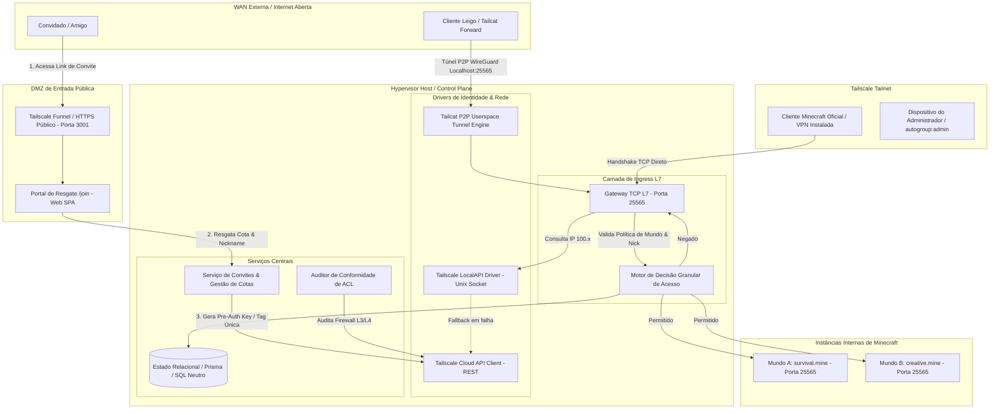
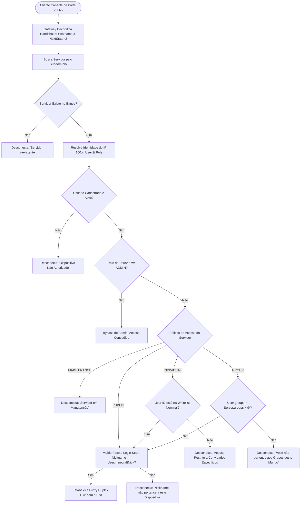
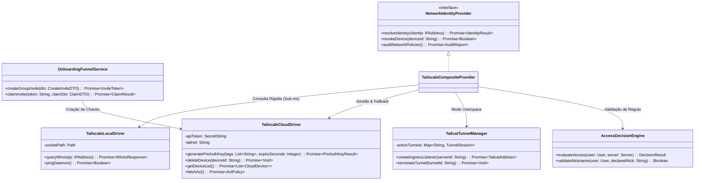
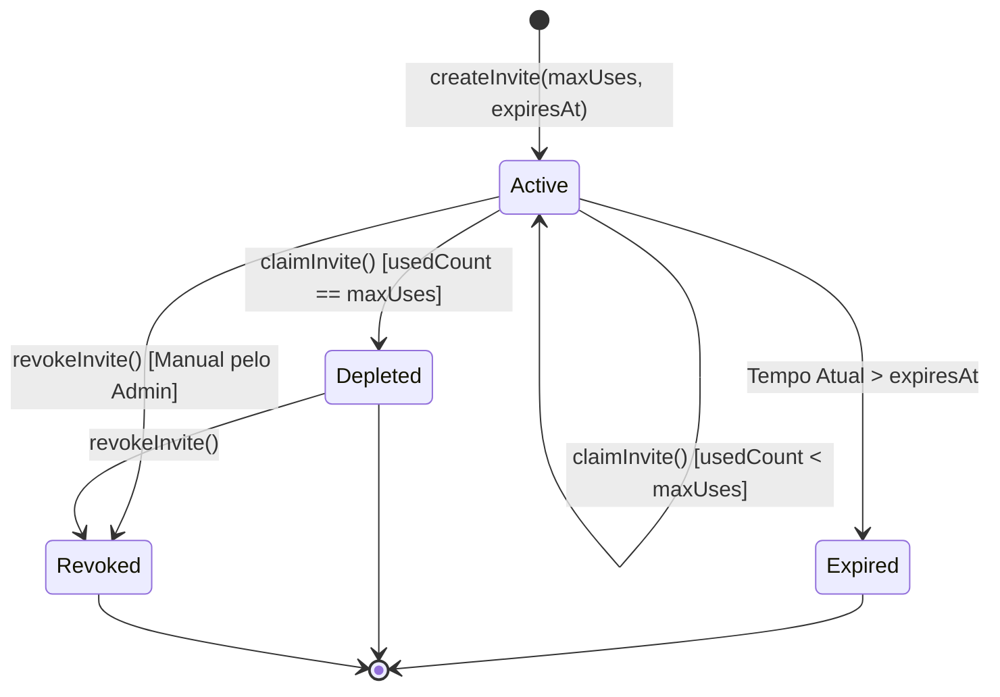
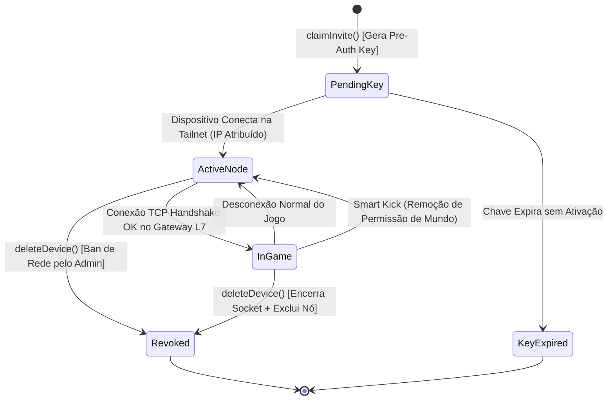
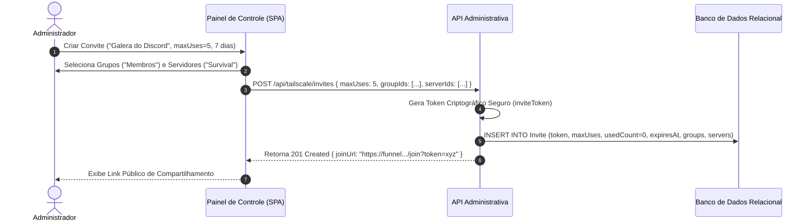
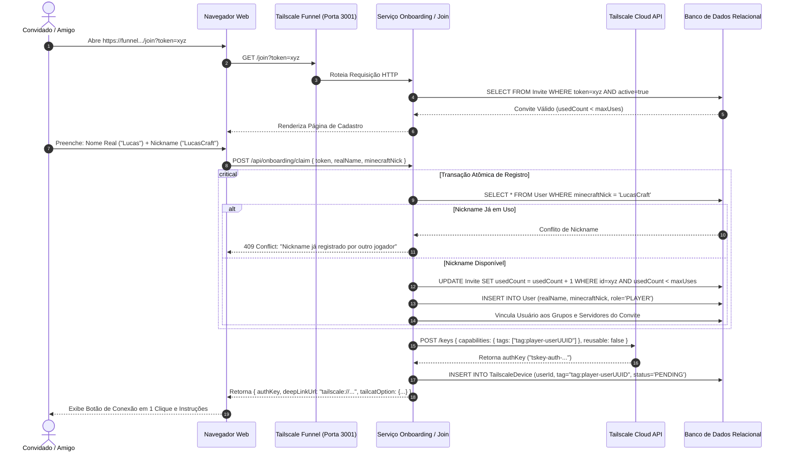
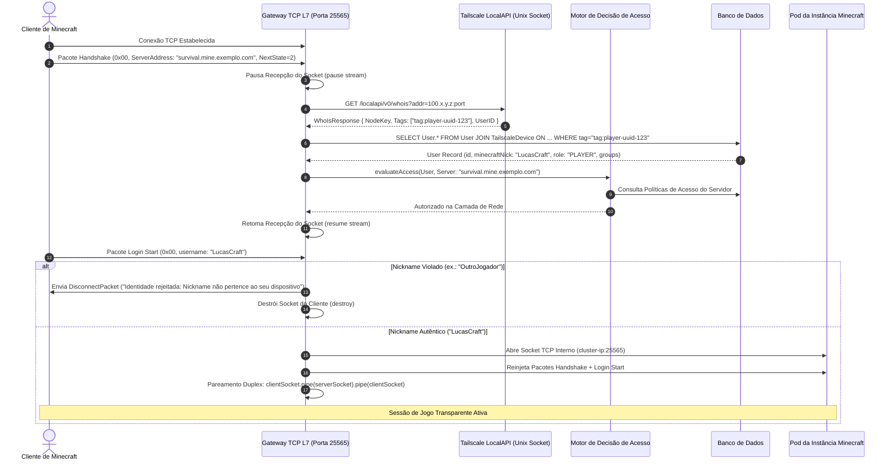
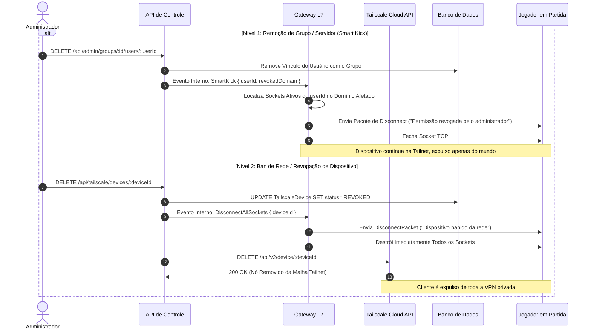
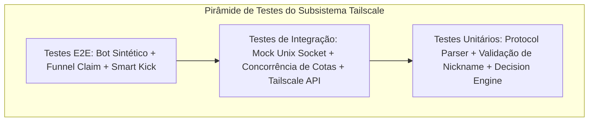

# Especificação de Requisitos de Software e Arquitetura de Sistemas (SRS)
## Subsistema de Rede Mesh Tailscale, Identidade Zero-Trust & Controle Granular de Acesso

---

### Sumário Executivo e Metadados do Subsistema
- **Projeto:** MineKubernetes — Next-Gen Game Server Hypervisor
- **Subsistema:** Tailscale Mesh, Zero-Trust Identity, Onboarding Funnel & Ingress Gateway
- **Perfil do Documento:** Especificação de Requisitos de Software (SRS), Arquitetura Agnóstica de Tecnologia e Matriz Formal de Testes
- **Público-Alvo:** Engenheiros de Software, Arquitetos de Redes, Especialistas em Segurança da Informação e Desenvolvedores de Plataforma

---



---

## 1. Visão Geral, Princípios Zero-Trust e Escopo

### 1.1 Princípios Fundamentais Zero-Trust
O subsistema de rede do Hypervisor opera sob o paradigma de **Confiança Zero (Zero-Trust Network Architecture - ZTNA)**:
1. **Nunca Confie, Sempre Verifique:** O fato de um pacote TCP originar-se de dentro da interface virtual da VPN privada não concede automaticamente acesso aos mundos de jogo. A identidade do dispositivo e a propriedade do jogador devem ser validadas a cada conexão.
2. **Menor Privilégio na Camada de Rede (L3/L4):** Dispositivos pertencentes a convidados (`tag:player-*`) são terminantemente impedidos de trafegar para qualquer porta ou endereço do ambiente de infraestrutura (homelab/cluster), exceto a porta TCP `25565` do nó do servidor de jogos.
3. **Validação em Duplo Estágio na Camada de Aplicação (L7):** A concessão final de entrada em uma instância de Minecraft específica depende da decodificação em tempo real do handshake do jogo, verificação do subdomínio e do pacote de autenticação de nome (`Login Start`), protegendo contra usurpação de identidade mesmo em servidores rodando em modo offline (`online-mode=false`).
4. **Isolamento de Credenciais de Acesso:** Chaves de autenticação pré-autorizadas (`Pre-Auth Keys`) geradas para convidados são de uso estritamente único (`reusable: false`), temporárias e atreladas à tag imutável do jogador.

---

## 2. Matriz de Controle Granular de Acesso aos Mundos

Mesmo que instâncias de jogos sejam criadas, atualizadas ou destruídas de forma declarativa e dinâmica, o motor de autorização deve avaliar cada solicitação de conexão com base em políticas determinísticas.



### 2.1 Políticas de Acesso por Instância (`AccessPolicy`)

| Política | Identificador Semântico | Regra de Autorização | Caso de Uso Típico |
| :--- | :--- | :--- | :--- |
| **Pública** | `PUBLIC` | Qualquer usuário cadastrado e autenticado na rede privada tem acesso concedido, independentemente de vínculos de grupo. | Servidores de Lobby comunitário, Spawn central ou minigames abertos a todos os convidados. |
| **Por Grupo** | `GROUP` | O usuário deve pertencer a pelo menos um dos grupos associados ao servidor: `User.groups ∩ Server.groups ≠ ∅`. | Mundos de modpacks pesados restritos a membros específicos (ex.: grupo "Veteranos", "Modpack-ATM9"). |
| **Individual / Nominal** | `INDIVIDUAL` | O identificador do usuário deve constar explicitamente na tabela de vínculos nominais da instância (`UserServerAccess`). | Servidores privados para duplas de amigos ou SMP exclusivo de criadores sem poluição de grupos. |
| **Manutenção** | `MAINTENANCE` | Conexões de jogadores comuns são imediatamente rejeitadas. Apenas identidades com `role = 'ADMIN'` têm permissão de entrada. | Janelas de migração de versão de jogo, aplicação de patches, restauração de chunks ou backups. |

### 2.2 Vínculo Antecipado de Permissões no Convite
Ao criar um convite no painel de controle ou via API, o operador pode vincular permissões de acesso previamente:
1. **Atribuição de Grupos ao Convite:** O convite carrega uma lista de `groupIds`. Todo jogador que resgatar esse convite é automaticamente adicionado aos respectivos grupos.
2. **Atribuição de Servidores Diretos:** O convite pode apontar diretamente para instâncias `INDIVIDUAL`, inserindo automaticamente o registro em `UserServerAccess` no momento em que o convite é resgatado.

---

## 3. Ingress para Usuários Leigos: Tailscale Gerenciado vs. Tailcat (Userspace P2P)

### 3.1 O Desafio de Acessibilidade para Usuários Leigos
O modelo padrão do Tailscale exige:
- Instalação de software no sistema operacional que cria adaptadores de rede virtual (driver TUN/Wintun).
- Privilégios de Administrador/UAC no Windows e `sudo` no Linux/macOS.
- Manipulação da tabela de roteamento e DNS do sistema operacional anfitrião.

Para amigos casuais e familiares sem conhecimentos técnicos ou permissões de administrador no computador (ex.: computadores compartilhados ou de trabalho), esse fluxo gera atrito e abandono do onboarding.

### 3.2 Matriz Comparativa de Soluções de Ingress

| Critério Técnico | Modo A: Tailscale Padrão (Tailnet Gerenciada) | Modo B: Tailcat (Userspace P2P Tunnel) |
| :--- | :--- | :--- |
| **Exigência de Conta** | **Nenhuma** (quando utilizado com Pre-Auth Keys via `/join`). | **Nenhuma** (comunicação baseada em endereço efêmero `tc...`). |
| **Privilégios no Sistema Operacional** | **Exige Administrador (Root/UAC)** para instalação do driver TUN. | **100% Userspace (Sem Root / Sem Admin)**: roda como binário portátil ou executável standalone. |
| **Modificação de Rotas / DNS do SO** | Modifica interface de rede e DNS do sistema (MagicDNS). | **Zero modificação de rede do SO**: atua apenas via loopback local (`127.0.0.1`). |
| **Mecanismo de Criptografia** | WireGuard nativo no kernel ou userspace via `tailscaled`. | WireGuard puro ponta a ponta (`magicsock` em userspace). |
| **Travessia de NAT (NAT Traversal)** | NAT Hole-Punching STUN/ICE com fallback para DERP Relays oficiais. | NAT Hole-Punching STUN/ICE com fallback para DERP Relays (tailcat.dev ou próprio). |
| **Topologia de Acesso do Jogo** | Conexão direta por subdomínio DNS: `survival.mine.dominio.com:25565`. | Conexão local mapeada: `localhost:25565` ou `127.0.0.1:25565`. |
| **Resolução de Identidade no Gateway** | IP virtual `100.x.y.z` consultado via LocalAPI WhoIs. | Endereço do túnel Tailcat pareado com o token de convite resgatado ou handshake do jogo. |

### 3.3 Arquitetura de Conexão com Tailcat
Para usuários que optarem pelo modo simplificado, o Portal `/join` oferece o download de um pacote portátil ultraleve (launcher helper ou script autocontido):
1. O Hypervisor provisiona um listener Tailcat exclusivo ou compartilhado via `tailcat serve 25565`.
2. O portal de resgate entrega ao cliente seu executável acompanhado do endereço de conexão do túnel (ex.: `tcA1b2C3...`).
3. O cliente executa o binário em background:
   ```bash
   tailcat forward tcA1b2C3... 25565:25565
   ```
4. O cliente abre seu Minecraft Java Edition nativo e conecta simplesmente no endereço:
   `localhost:25565`
5. O pacote TCP viaja pelo túnel WireGuard criptografado de userspace, perfura o NAT da casa do jogador diretamente para o Hypervisor, e atinge o Gateway L7 onde é validado normalmente pelo pacote `Login Start`.

---

## 4. Arquitetura de Componentes e Interfaces Abstratas (Agnóstica de Tecnologia)



### 4.1 Interface Abstrata do Provedor de Identidade (`NetworkIdentityProvider`)
A comunicação entre o núcleo do Hypervisor/Gateway L7 e o sistema de rede deve ser totalmente desacoplada de SDKs de terceiros:
```
interface NetworkIdentityProvider:
    method resolveIdentity(clientIp: String) -> Result<NetworkIdentity, ResolutionError>
    method revokeDevice(deviceId: String) -> Result<Void, NetworkError>
    method generateInviteKey(tags: List<String>, expirySeconds: Integer) -> Result<PreAuthKey, NetworkError>
    method auditAclCompliance() -> Result<AclComplianceReport, NetworkError>
```

---

## 5. Máquinas de Estados e Ciclos de Vida

### 5.1 Ciclo de Vida do Convite Compartilhado (`Invite`)



| Estado | Significado Semântico | Comportamento no Portal `/join` |
| :--- | :--- | :--- |
| **`Active`** | O convite está válido e possui cotas disponíveis (`usedCount < maxUses`). | Exibe formulário de cadastro de Nome Real e Nickname. Permite reivindicação. |
| **`Depleted`** | O limite de utilizações foi alcançado (`usedCount == maxUses`). | Bloqueia novas reivindicações informando que a cota foi atingida. |
| **`Expired`** | A data de expiração foi ultrapassada (`now() > expiresAt`). | Bloqueia novas reivindicações informando que o link perdeu a validade. |
| **`Revoked`** | O administrador cancelou explicitamente o convite antes do esgotamento. | Rejeita requisições imediatamente com mensagem de convite cancelado. |

### 5.2 Ciclo de Vida do Dispositivo Tailscale (`TailscaleDevice`)



---

## 6. Fluxos de Sequência Detalhados

### 6.1 Fluxo 1: Emissão de Convite Multi-Uso com Permissões Pré-Atribuídas



### 6.2 Fluxo 2: Resgate no Portal `/join`, Validação de Nickname e Provisionamento



### 6.3 Fluxo 3: Conexão TCP no Gateway L7 e Validação Anti-Impersonation



### 6.4 Fluxo 4: Revogação em Dois Níveis (Smart Kick vs. Ban de Rede)



---

## 7. Modelo de Dados Relacional Neutro & DTOs

### 7.1 Esquema Entidade-Relacionamento Neutro (SQL DDL Neutro)

```sql
-- Usuários do Sistema (Jogadores e Administradores)
CREATE TABLE users (
    id VARCHAR(36) PRIMARY KEY,
    real_name VARCHAR(120) NOT NULL,
    minecraft_nick VARCHAR(16) NOT NULL UNIQUE,
    role VARCHAR(20) NOT NULL DEFAULT 'PLAYER', -- 'ADMIN', 'PLAYER'
    created_at TIMESTAMP WITH TIME ZONE DEFAULT CURRENT_TIMESTAMP,
    updated_at TIMESTAMP WITH TIME ZONE DEFAULT CURRENT_TIMESTAMP
);

CREATE INDEX idx_users_minecraft_nick ON users(minecraft_nick);

-- Dispositivos Tailscale vinculados aos Usuários (Relação 1:N)
CREATE TABLE tailscale_devices (
    id VARCHAR(36) PRIMARY KEY,
    user_id VARCHAR(36) NOT NULL REFERENCES users(id) ON DELETE CASCADE,
    node_id VARCHAR(100) UNIQUE, -- ID do nó na API do Tailscale
    node_ip VARCHAR(45),         -- Endereço IPv4/IPv6 (ex.: 100.x.y.z)
    tailscale_tag VARCHAR(100) NOT NULL UNIQUE, -- ex.: 'tag:player-uuid'
    device_name VARCHAR(150),
    status VARCHAR(20) NOT NULL DEFAULT 'PENDING', -- 'PENDING', 'ACTIVE', 'REVOKED'
    last_seen_at TIMESTAMP WITH TIME ZONE,
    created_at TIMESTAMP WITH TIME ZONE DEFAULT CURRENT_TIMESTAMP
);

CREATE INDEX idx_devices_tailscale_tag ON tailscale_devices(tailscale_tag);
CREATE INDEX idx_devices_node_ip ON tailscale_devices(node_ip);

-- Convites Compartilhados com Cotas de Uso
CREATE TABLE invites (
    id VARCHAR(36) PRIMARY KEY,
    token VARCHAR(64) NOT NULL UNIQUE,
    name VARCHAR(100) NOT NULL,
    max_uses INT NOT NULL DEFAULT 1,
    used_count INT NOT NULL DEFAULT 0,
    expires_at TIMESTAMP WITH TIME ZONE NOT NULL,
    is_active BOOLEAN NOT NULL DEFAULT TRUE,
    created_at TIMESTAMP WITH TIME ZONE DEFAULT CURRENT_TIMESTAMP
);

CREATE INDEX idx_invites_token ON invites(token);

-- Grupos de Acesso Granular
CREATE TABLE groups (
    id VARCHAR(36) PRIMARY KEY,
    name VARCHAR(80) NOT NULL UNIQUE,
    description TEXT,
    created_at TIMESTAMP WITH TIME ZONE DEFAULT CURRENT_TIMESTAMP
);

-- Relação N:N Usuário <-> Grupo
CREATE TABLE user_groups (
    user_id VARCHAR(36) NOT NULL REFERENCES users(id) ON DELETE CASCADE,
    group_id VARCHAR(36) NOT NULL REFERENCES groups(id) ON DELETE CASCADE,
    PRIMARY KEY (user_id, group_id)
);

-- Relação N:N Servidor <-> Grupo
CREATE TABLE server_groups (
    server_id VARCHAR(36) NOT NULL, -- ID do servidor gerenciado
    group_id VARCHAR(36) NOT NULL REFERENCES groups(id) ON DELETE CASCADE,
    PRIMARY KEY (server_id, group_id)
);

-- Acesso Individual Nominal: Usuário <-> Servidor (Política INDIVIDUAL)
CREATE TABLE user_server_access (
    user_id VARCHAR(36) NOT NULL REFERENCES users(id) ON DELETE CASCADE,
    server_id VARCHAR(36) NOT NULL,
    granted_at TIMESTAMP WITH TIME ZONE DEFAULT CURRENT_TIMESTAMP,
    PRIMARY KEY (user_id, server_id)
);

-- Vínculos Pré-Atribuídos de Convite para Grupos
CREATE TABLE invite_groups (
    invite_id VARCHAR(36) NOT NULL REFERENCES invites(id) ON DELETE CASCADE,
    group_id VARCHAR(36) NOT NULL REFERENCES groups(id) ON DELETE CASCADE,
    PRIMARY KEY (invite_id, group_id)
);

-- Vínculos Pré-Atribuídos de Convite para Servidores
CREATE TABLE invite_servers (
    invite_id VARCHAR(36) NOT NULL REFERENCES invites(id) ON DELETE CASCADE,
    server_id VARCHAR(36) NOT NULL,
    PRIMARY KEY (invite_id, server_id)
);
```

### 7.2 Especificação dos Contratos de Dados (DTOs / JSON Schema)

```json
// CreateInviteDTO
{
  "$schema": "http://json-schema.org/draft-07/schema#",
  "title": "CreateInviteDTO",
  "type": "object",
  "properties": {
    "name": { "type": "string", "minLength": 3, "maxLength": 100 },
    "maxUses": { "type": "integer", "minimum": 1, "maximum": 500, "default": 1 },
    "expiresInDays": { "type": "integer", "minimum": 1, "maximum": 90, "default": 7 },
    "groupIds": { "type": "array", "items": { "type": "string" } },
    "serverIds": { "type": "array", "items": { "type": "string" } }
  },
  "required": ["name"]
}

// ClaimInviteDTO
{
  "$schema": "http://json-schema.org/draft-07/schema#",
  "title": "ClaimInviteDTO",
  "type": "object",
  "properties": {
    "token": { "type": "string", "minLength": 16 },
    "realName": { "type": "string", "minLength": 2, "maxLength": 100 },
    "minecraftNick": { "type": "string", "pattern": "^[a-zA-Z0-9_]{3,16}$" }
  },
  "required": ["token", "realName", "minecraftNick"]
}

// ClaimResultDTO
{
  "$schema": "http://json-schema.org/draft-07/schema#",
  "title": "ClaimResultDTO",
  "type": "object",
  "properties": {
    "userId": { "type": "string" },
    "realName": { "type": "string" },
    "minecraftNick": { "type": "string" },
    "authKey": { "type": "string" },
    "deepLinkUrl": { "type": "string" },
    "tailcatTunnel": {
      "type": "object",
      "properties": {
        "serverAddress": { "type": "string" },
        "instructions": { "type": "string" }
      }
    },
    "expiresAt": { "type": "string", "format": "date-time" }
  },
  "required": ["userId", "minecraftNick", "authKey"]
}
```

---

## 8. Firewall L3/L4, Auditoria de ACL e Isolamento do Homelab

### 8.1 Estrutura Canônica de Regras do Tailscale (Tailscale ACL Policy)
Para evitar que a concessão de acesso à VPN exponha serviços críticos de infraestrutura (Proxmox, Vaultwarden, AdGuard Home, SSH), a Tailnet deve aplicar rigorosamente a seguinte política declarativa:

```json
{
  "tagOwners": {
    "tag:minecraft-server": ["autogroup:admin"],
    "tag:player-*": ["autogroup:admin"]
  },

  "grants": [
    // 1. Administradores mantêm acesso irrestrito à infraestrutura
    {
      "src": ["autogroup:admin"],
      "dst": ["*"],
      "ip": ["*"]
    },

    // 2. Jogadores/Convidados têm permissão ÚNICA para a porta 25565 do Servidor
    {
      "src": ["tag:player-*"],
      "dst": ["tag:minecraft-server"],
      "ip": ["tcp:25565"]
    }
  ],

  "tests": [
    {
      "src": "tag:player-test",
      "accept": ["tag:minecraft-server:25565"],
      "deny": [
        "tag:minecraft-server:22",
        "tag:minecraft-server:3000",
        "192.168.1.0/24:*"
      ]
    }
  ]
}
```

### 8.2 Algoritmo de Auditoria e Verificação de Postura no Boot
Durante a inicialização do Hypervisor, o serviço `AuditService` deve executar uma verificação não destrutiva da política de ACL:
1. Executa requisição `GET /api/v2/tailnet/{tailnet}/acl`.
2. Avalia a lista de `grants` e `acls`:
   - Verifica se existe regra curinga ampla (`src: ["*"]` ou `src: ["tag:player-*"]` com destino irrestrito `dst: ["*"]`).
   - Se for detectado vazamento de privilégio, o Hypervisor emite alerta crítico no painel administrativo e marca a postura de segurança como **`VULNERABLE`**.
   - O Hypervisor **não deve sobrescrever a ACL automaticamente sem autorização explícita**, prevenindo o bloqueio acidental do administrador fora do homelab.

---

## 9. Especificação Formal da Estratégia de Testes (Test Pyramid)



### 9.1 Matriz de Testes Unitários

| Componente Alvo | Cenário de Teste | Entrada (Given) | Ação (When) | Resultado Esperado (Then) |
| :--- | :--- | :--- | :--- | :--- |
| **`MinecraftProtocol`** | Handshake Vanilla Válido | Buffer TCP com VarInt length, Packet ID `0x00`, Host `survival.mine.net`, Porta `25565`, NextState `2`. | Executa `readHandshakePacket(buffer)`. | Retorna objeto tipado com hostname extraído e `nextState = 2`. |
| **`MinecraftProtocol`** | Sanitização de Modloaders (Forge/NeoForge) | Hostname contendo null-bytes: `"atm9.mine.net\0FML3\0"`. | Executa `readHandshakePacket(buffer)`. | Limpa a string retornando estritamente `"atm9.mine.net"`. |
| **`NicknameValidator`** | Nickname de Minecraft Válido | String `"Player_One"`, tamanho 10. | Executa `validate(nick)`. | Retorna `true`. |
| **`NicknameValidator`** | Nickname Inválido / Path Traversal / Espaços | Strings `"User name"`, `"../../etc"`, `"A"`, `"NickMaisLongoQue16Chars"`. | Executa `validate(nick)`. | Retorna `false` com código de erro de formato. |
| **`DecisionEngine`** | Acesso ao Servidor Público | Usuário regular `role='PLAYER'`, Servidor com `policy='PUBLIC'`. | Executa `evaluateAccess(user, server)`. | Retorna `authorized: true`. |
| **`DecisionEngine`** | Acesso Negado por Grupos Disjuntos | Usuário no grupo `["Modpack-A"]`, Servidor nos grupos `["Modpack-B"]`. | Executa `evaluateAccess(user, server)`. | Retorna `authorized: false` com motivo `INSUFFICIENT_GROUPS`. |
| **`DecisionEngine`** | Bypass de Administrador em Manutenção | Usuário `role='ADMIN'`, Servidor com `policy='MAINTENANCE'`. | Executa `evaluateAccess(user, server)`. | Retorna `authorized: true` (Admin bypass). |
| **`DecisionEngine`** | Bloqueio de Jogador em Manutenção | Usuário `role='PLAYER'`, Servidor com `policy='MAINTENANCE'`. | Executa `evaluateAccess(user, server)`. | Retorna `authorized: false` com motivo `SERVER_IN_MAINTENANCE`. |

### 9.2 Matriz de Testes de Integração

| Componente Alvo | Cenário de Teste | Estratégia de Isolamento / Mock | Resultado Esperado |
| :--- | :--- | :--- | :--- |
| **`TailscaleLocalDriver`** | Resolução de IP via Unix Socket | Mock de servidor de Unix Socket respondendo no protocolo HTTP LocalAPI WhoIs. | Retorna a tag `tag:player-xyz` em menos de 5ms sem acionar rede externa. |
| **`TailscaleCompositeDriver`** | Fallback de Socket Local para Cloud API | Simulação de indisponibilidade do arquivo `/var/run/tailscale/tailscaled.sock` (`ENOENT`). | Dispara fallback gracioso para a API REST da Cloud mantendo cache com TTL de 300 segundos. |
| **`InviteQuotaManager`** | Concorrência Crítica de Cotas (Race Conditions) | 10 requisições simultâneas de `claimInvite` para um convite com `maxUses = 1`. | Exatamente 1 requisição obtém sucesso (201); 9 requisições recebem erro 410/409 (Esgotado). Nenhuma cota negativa permitida. |
| **`TailscaleCloudDriver`** | Tratamento de Rate Limit (HTTP 429) | Mock HTTP retornando cabeçalho `Retry-After: 5`. | Aplica política de backoff exponencial e notifica logs estruturados. |

### 9.3 Matriz de Testes End-to-End (E2E) & Testes com Bot Sintético

| Identificador | Título do Teste E2E | Passos de Execução Automatizados | Critério de Aceite / Asserção |
| :--- | :--- | :--- | :--- |
| **`E2E-01`** | **Jornada de Resgate Completa no Funnel** | 1. API cria convite.<br>2. Cliente HTTP automatizado faz `POST /claim` com Nick `TestBot`.<br>3. Valida criação do registro no banco e chave retornada. | Status `201 Created`. Registro existe na tabela `users` vinculado à tag criada. |
| **`E2E-02`** | **Handshake TCP com Bot Headless e Login com Sucesso** | 1. Bot sintetizador de pacotes TCP conecta na porta `25565`.<br>2. Injeta IP simulado autorizado.<br>3. Envia Handshake e `Login Start` com o nick `TestBot`. | Socket permanece aberto e bytes são repassados ao mock do servidor interno sem desconexão. |
| **`E2E-03`** | **Rejeição Imediata por Tentativa de Impersonação** | 1. Bot conecta a partir do IP do jogador A.<br>2. Envia pacote `Login Start` contendo o nickname registrado do jogador B. | Gateway intercepta o pacote, envia pacote binário de Disconnect com texto formatado e encerra o socket em menos de 50ms. |
| **`E2E-04`** | **Smart Kick sob Revogação de Permissão em Tempo Real** | 1. Bot mantém sessão TCP duplex ativa.<br>2. Operação na API remove o jogador do grupo associado à instância. | Gateway dispara desconexão imediata do socket ativo e o bot recebe pacote de disconnect contendo `"Permissão revogada"`. |

### 9.4 Matriz de Testes de Segurança e Penetração (Red Team)

| ID | Vetor de Ataque Simulado | Comportamento Esperado do Subsistema |
| :--- | :--- | :--- |
| **`SEC-01`** | Conexão originada de IP fora da faixa CGNAT da Tailnet (`100.64.0.0/10`). | Gateway L7 rejeita a conexão sumariamente no primeiro byte sem alocar buffer de aplicação. |
| **`SEC-02`** | Escaneamento de portas internas a partir do IP do jogador (ex.: porta 3000 API, porta 22 SSH). | Pacotes descartados pela política de Firewall L3/L4 (`grants` estritos da Tailnet). Zero resposta (Drop silencioso). |
| **`SEC-03`** | Injeção de delimitadores nulos (`\0`) e comandos no Handshake para forçar falhas de buffer no Gateway. | Parser trata null-bytes como caracteres de terminação segura, isolando a string sem falhas de buffer ou estouro de memória. |

---

## 10. Casos de Borda e Resiliência Operacional

| Cenário de Borda | Risco para o Subsistema | Mitigação Arquitetural Obrigatória |
| :--- | :--- | :--- |
| **Indisponibilidade da WAN / API Tailscale** | Falha de criação de novos convites e bloqueio de novos logins se a resolução depender da nuvem. | Cache local em memória indexado por IP e prioridade absoluta para a LocalAPI IPC (que opera sem internet enquanto o daemon local estiver ativo). |
| **Múltiplos Dispositivos Conectando com o Mesmo Nick** | Dois dispositivos pertencentes ao mesmo jogador (ex.: PC e Notebook) tentam entrar no mesmo mundo simultaneamente. | O Minecraft Protocol nativamente rejeita a segunda conexão ("You logged in from another location"). O Gateway apenas garante que ambos os IPs pertencem ao mesmo usuário antes de repassar. |
| **Dispositivos Órfãos / Inativos na Tailnet** | Convidados que jogaram uma única vez acumulam centenas de nós na conta Tailscale, atingindo o limite de nós do plano gratuito (100 dispositivos). | Job cron periódico (`DeviceGarbageCollector`): Nós marcados com `last_seen_at > 30 dias` e sem atividade são automaticamente deletados via API da Tailscale. |
| **Troca Dinâmica de IP do Nó do Hypervisor** | Reinicialização do serviço Tailscale altera o IP do nó do host. | O script de bootstrap registra o novo IP no registro DNS Wildcard (`*.mine...`) automaticamente via API de DNS (ex.: Cloudflare API). |
