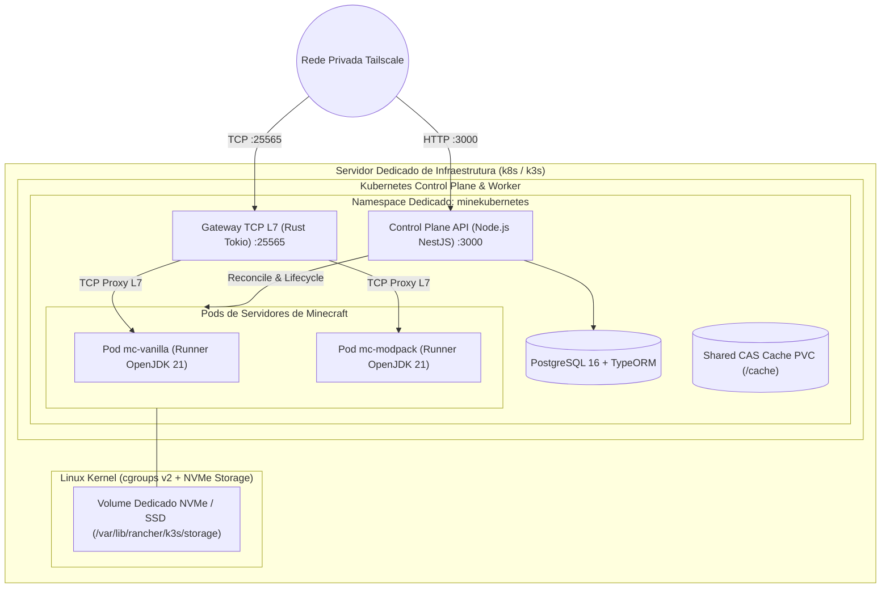
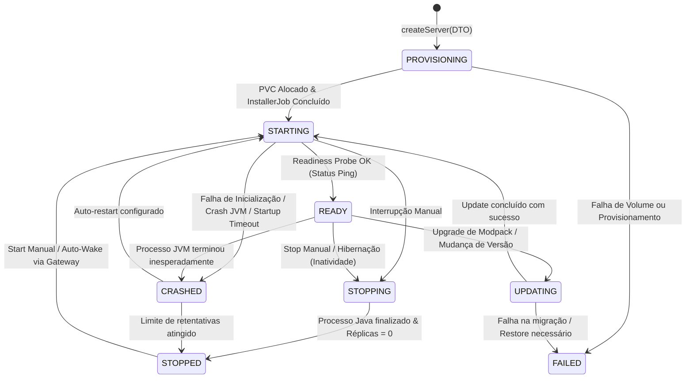

# Especificação de Requisitos de Software & Arquitetura (SRS)
## Módulo 01: Arquitetura Geral & Visão de Infraestrutura

**Metadados do Documento:**
- **Sistema:** MineKubernetes — Next-Gen Game Server Hypervisor
- **Módulo:** 01 — Arquitetura Geral, Topologia e Ciclo de Vida
- **Fase de Referência:** F0 — Consolidar SRS
- **Issues Resolvidas:** [#2](https://github.com/BGLuis/mineK8s/issues/2), [#16](https://github.com/BGLuis/mineK8s/issues/16) (C-01), [#23](https://github.com/BGLuis/mineK8s/issues/23) (C-08), [#24](https://github.com/BGLuis/mineK8s/issues/24) (C-09), [#26](https://github.com/BGLuis/mineK8s/issues/26) (C-11), [#29](https://github.com/BGLuis/mineK8s/issues/29) (C-14), [#32](https://github.com/BGLuis/mineK8s/issues/32) (C-17), [#34](https://github.com/BGLuis/mineK8s/issues/34) (C-19), [#44](https://github.com/BGLuis/mineK8s/issues/44)

---

## 1. Visão Geral do Sistema

O **MineKubernetes** é um Hypervisor de Jogos e Plano de Controle (Control Plane) de alto desempenho projetado para orquestrar dinamicamente servidores de Minecraft (Vanilla, Paper, Purpur) e Modpacks de alta complexidade (Forge, NeoForge, Fabric, Quilt) sobre Kubernetes (k8s/k3s).

O sistema resolve os três maiores desafios de operar servidores de jogos em contêineres:
1. **Ponto Único de Entrada de Rede com Despacho L7:** Roteamento de conexões TCP de Minecraft na porta padrão `25565` para Pods internos isolados utilizando inspeção de handshake de domínio (Virtual Hosting) e segurança Zero-Trust via Tailscale.
2. **Eficiência de Recursos (Scale-to-Zero):** Hibernação automática de mundos sem jogadores online e reativação dinâmica sob demanda (Auto-Wake) quando um jogador tenta conectar.
3. **Integridade de Processos e I/O de Disco:** Garantia de consistência transacional em snapshots de mundo, execução de comandos RCON binários persistentes (sem shell execution) e isolamento estrito de recursos do sistema hospedeiro.

---

## 2. Topologia do Cluster & Infraestrutura (Resolução [#44], [#26])



### 2.1 Requisitos do Cluster
- **Cluster Alvo:** Kubernetes padrão ou k3s em nó dedicado de produção com **cgroups v2 habilitados** (`systemd.unified_cgroup_hierarchy=1`).
- **Namespace Único e Isolado:** Todo e qualquer recurso orquestrado pelo Hypervisor reside obrigatoriamente no namespace `minekubernetes`. Workloads de outros tenants no mesmo cluster (como ambientes de desenvolvimento ou projetos paralelos no `default`) não são acessados, modificados ou visualizados pelo Hypervisor (Resolução **C-11**).
- **Storage Class:** `local-path` mapeado em disco local NVMe/SSD de alta velocidade. Volumes de instâncias (`/data`) são declarados como `ReadWriteOnce` (RWO) com `nodeAffinity` configurada para o nó de armazenamento local.
- **Cache de Modpacks (`/cache`):** Armazenamento de arquivos CAS (Content Addressable Storage) montado via volume local de alta capacidade para permitir download compartilhado entre diferentes instâncias.

---

## 3. Runtimes Oficiais do Sistema (Resolução [#34] / C-19)

O Hypervisor adota explicitamente uma **arquitetura poliglota especializada**:

| Componente | Runtime / Linguagem | Justificativa Arquitetural |
| :--- | :--- | :--- |
| **Gateway TCP L7** | **Rust** (`tokio`, `bytes`) | Baixa latência imperativa para tráfego de jogos, zero GC pauses, manipulação direta de buffers de rede e consumo mínimo de memória (15–30 MB RSS). |
| **Control Plane API** | **Node.js 20+** (`NestJS`, `TypeORM`, `TypeScript`) | Alta produtividade para lógica de domínio complexa, integração rica com ecossistema de APIs (Tailscale, Modrinth, CurseForge, Mojang), ORM tipado e gestão de eventos assíncronos. |
| **Interface Web SPA** | **Angular 18+** (`TypeScript`, `TailwindCSS/SCSS`) | Single Page Application moderna, componentes desacoplados para monitoramento em tempo real (WebSockets) e terminal interativo. |
| **Pods de Jogo (Runners)** | **Linux Container** (`eclipse-temurin:21-jre-jammy`) | Imagem oficial OpenJDK, sem entrypoints proprietários de terceiros, auditável e previsível. |

---

## 4. Máquina de Estados da Instância (Resolução [#16] / C-01)

O ciclo de vida da instância de Minecraft segue uma máquina de estados estrita. A tabela abaixo unifica e substitui qualquer divergência prévia entre documentações:



### 4.1 Definição dos Estados
1. `PROVISIONING`: Estado inicial transitório. PVCs e ConfigMaps estão sendo alocados.
2. `STARTING`: Pod do Kubernetes instanciado. O processo Java iniciou a carga de classes e mundos.
3. `READY`: A thread de rede da JVM abriu a porta 25565 e respondeu com sucesso ao **Minecraft Status Ping**. O servidor aceita jogadores.
4. `STOPPING`: Execução de graceful shutdown: `save-all flush`, notificação aos jogadores e envio do comando `stop` via RCON.
5. `STOPPED`: O Pod foi finalizado com sucesso (`replicas: 0`). Consome 0 CPU e 0 RAM no cluster (Modo Hibernado / Scale-to-Zero).
6. `UPDATING`: Um job de atualização de mods ou versão do servidor está alterando os arquivos em `/data`.
7. `CRASHED`: A JVM encerrou com exit code diferente de 0 ou falhou repetidamente no Watchdog.
8. `FAILED`: Ocorreu uma falha irrecuperável de infraestrutura (falta de espaço em disco, erro de permissão).

> [!NOTE]
> **Modo Manutenção (`is_maintenance`):** O estado `MAINTENANCE` **não é um estado do contêiner**, mas sim uma flag booleana de política na tabela de instâncias. Quando `is_maintenance = true`, o servidor pode estar fisicamente `READY`, mas o Gateway L7 rejeita jogadores comuns com mensagem explicativa e autoriza apenas administradores.

---

## 5. Parâmetros de Recursos e Monitoramento da JVM

### 5.1 Margem de Memória do Container cgroups (Resolução [#32] / C-17)
Servidores Minecraft alocam memória off-heap substancial (Metaspace, JIT compiler code cache, buffers de rede Netty/NIO, thread stacks e alocações do glibc). Configurar o limite de container cgroups próximo demais do `-Xmx` da JVM resulta em disparos arbitrários do **OOMKiller** do kernel Linux.

A fórmula de alocação de memória do Pod é obrigatória:
$$\text{resources.limits.memory} = \text{Xmx (Heap)} + 1.5\text{ GiB (Overhead Nativo Mínimo)}$$

*Exemplos de Dimensionamento:*
- Servidor Vanilla / Paper Leve: `Heap: 3 GiB` $\rightarrow$ `Container Limit: 4.5 GiB`
- Modpack Médio (150 mods): `Heap: 6 GiB` $\rightarrow$ `Container Limit: 7.5 GiB`
- Modpack Pesado (300+ mods, GregTech/AllTheMods): `Heap: 10 GiB` $\rightarrow$ `Container Limit: 12.0 GiB`

### 5.2 Janelas de Startup Probe (Resolução [#24] / C-09)
O tempo de inicialização varia drasticamente entre tipos de servidores. Para evitar reinicializações prematuras pelo Kubernetes, são definidos dois perfis canônicos:

```yaml
# Perfil Vanilla / Paper:
startupProbe:
  tcpSocket:
    port: 25565
  initialDelaySeconds: 15
  periodSeconds: 10
  timeoutSeconds: 2
  failureThreshold: 18 # Tolerância máxima: 195 segundos (~3.25 min)

# Perfil Modpack Pesado (Forge / NeoForge / Fabric):
startupProbe:
  tcpSocket:
    port: 25565
  initialDelaySeconds: 30
  periodSeconds: 10
  timeoutSeconds: 3
  failureThreshold: 90 # Tolerância máxima: 930 segundos (15.5 min)
```

### 5.3 Readiness Probe por Status Ping (Resolução [#29] / C-14)
Abertura de porta TCP bruta não comprova que a engine do Minecraft carregou os mundos e está pronta para conexões. A verificação de prontidão (`readinessProbe`) é executada via comando interno que emite o handshake binário de **Server List Ping (SLP)** do protocolo Minecraft. O Pod só é marcado como `Ready` quando o servidor responder com o pacote JSON de status contendo a versão e a contagem de jogadores.

### 5.4 Política de `max-tick-time` (Resolução [#23] / C-08)
- **Vanilla / Paper:** Mantido o padrão `max-tick-time=60000` (60 segundos) no `server.properties`. Se o loop principal travar por mais de um minuto, o watchdog da JVM mata o processo.
- **Modpacks Pesados:** Configurado `max-tick-time=-1` no `server.properties`. Durante geração pesada de chunks ou carregamento dimensional inicial de mods, ticks únicos podem exceder 60 segundos legitimamente. A proteção contra deadlocks reais fica delegada ao Watchdog externo do Hypervisor, que monitora métricas de CPU e I/O antes de reiniciar a instância.
