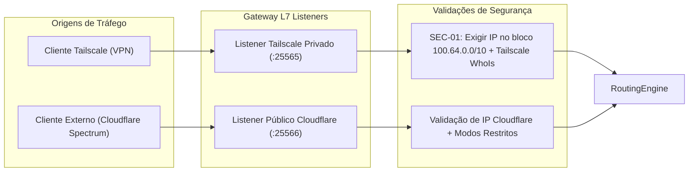

# Especificação de Requisitos de Software & Arquitetura (SRS)
## Módulo 02: Gateway Reverso TCP L7

**Metadados do Documento:**
- **Sistema:** MineKubernetes — Next-Gen Game Server Hypervisor
- **Módulo:** 02 — Gateway TCP L7, Virtual Hosting e Protocolo Minecraft
- **Fase de Referência:** F0 — Consolidar SRS
- **Issues Resolvidas:** [#8](https://github.com/BGLuis/mineK8s/issues/8) (E-06), [#9](https://github.com/BGLuis/mineK8s/issues/9) (E-07), [#21](https://github.com/BGLuis/mineK8s/issues/21) (C-06), [#22](https://github.com/BGLuis/mineK8s/issues/22) (C-07), [#27](https://github.com/BGLuis/mineK8s/issues/27) (C-12), [#28](https://github.com/BGLuis/mineK8s/issues/28) (C-13)

---

## 1. Responsabilidade do Gateway

O **Gateway TCP L7** é o ponto de terminação e controle de todas as conexões de jogadores de Minecraft. Ele escuta na porta padrão `25565`, inspeciona o primeiro pacote do protocolo de jogo (**Handshake Packet 0x00**), autentica a identidade do jogador contra a malha Tailscale e o banco de dados do Control Plane, e realiza o roteamento transparente para o Pod da respectiva instância de jogo.

Implementado em **Rust** utilizando o runtime assíncrono `tokio`, o Gateway opera com latência sub-milissegundo, alocação de memória determinística e zero pausas de Garbage Collector.

---

## 2. Decodificação do Pacote Handshake (Resolução [#8] / E-06)

O cliente de Minecraft inicia qualquer interação TCP enviando um pacote de Handshake estruturado em protocolo binário:

```
[Packet Length: VarInt] [Packet ID: VarInt = 0x00]
[Protocol Version: VarInt]
[Server Address: String (VarInt length + UTF-8)]
[Server Port: Unsigned Short (16 bits big-endian)]
[Next State / Intent: VarInt]
```

### 2.1 Suporte a Intent 3 (Transferência de Servidor)
As versões originais da especificação consideravam apenas as intenções 1 e 2. No Minecraft 1.20.5+ (Protocolo 766+), a Mojang introduziu oficialmente o **Intent 3 (Transfer)**, que permite a clientes serem transferidos entre servidores sem fechar a conexão física:

| Intent ID | Semântica do Protocolo | Tratamento no Gateway L7 |
| :---: | :--- | :--- |
| `1` | **Status (Server List Ping)** | Consulta de MOTD, ícone e contagem de jogadores. Gateway responde diretamente caso a instância esteja hibernada (`STOPPED`), ou repassa o ping para o Pod se `READY`. |
| `2` | **Login (Autenticação / Entrada)** | Tentativa de conexão ao mundo. O Gateway valida identidade, verifica permissão e dispara Auto-Wake se o servidor estiver hibernado. |
| `3` | **Transfer (Transferência Direta)** | Roteado com as mesmas regras estritas de **Login (Intent 2)**. A identidade é checada e o tráfego é direcionado para a nova instância solicitada. |

### 2.2 Tratamento de Null-Bytes em Modloaders (Forge / NeoForge)
Launchers e modloaders modificados (Forge, NeoForge, FML) anexam sufixos proprietários no campo `server_address` (exemplo: `survival.mine.internal\0FML3\0` ou `modpack.internal\0FML\0`).
- **Regra de Parsing:** O Gateway deve truncar obrigatoriamente a string de endereço no **primeiro caractere nulo (`\0`)** antes de realizar a consulta da rota na tabela de domínios.

---

## 3. Roteamento com Registros DNS SRV (Resolução [#9] / E-07)

Quando um jogador configura um endereço com registro DNS SRV no cliente (ex.: `_minecraft._tcp.jogar.exemplo.com -> srv-node01.mine.internal:25565`):
- **Comportamento Documentado do Cliente Minecraft (MC-68884):** O cliente Java frequentemente preenche o campo `server_address` do pacote Handshake com o **hostname alvo resolvido** (`srv-node01.mine.internal`), e não o domínio original digitado (`jogar.exemplo.com`).
- **Resolução Arquitetural:** 
  1. A tabela de rotas do Gateway deve suportar múltiplos **aliases de domínio** para uma mesma instância de servidor.
  2. O Control Plane, ao provisionar um domínio ou configurar DNS, registra tanto o FQDN público quanto os targets de registros SRV associados como chaves válidas de roteamento no mapa de memória do Gateway.

---

## 4. Gerenciamento de Sessões & Smart Kick (Resolução [#8], [#28])

### 4.1 Sessões Duplicadas (Resolução [#28] / C-13)
Se um jogador tentar estabelecer uma nova conexão com o mesmo UUID/Nickname enquanto uma sessão anterior ainda estiver ativa:
- **Política Canônica:** O Gateway encerra imediatamente a conexão anterior e transfere o fluxo para a nova sessão estabelecida. Essa abordagem evita conexões órfãs (*ghost sessions*) causadas por quedas abruptas de conexão do cliente sem envio de TCP FIN.

### 4.2 Desconexão em Sessões Ativas (Smart Kick sob Compressão)
Uma vez que o Handshake e a fase de Login são concluídos e o Gateway entra em modo **ActiveProxy** (despacho transparente bidirecional de bytes TCP):
- **O Problema:** Durante a fase de jogo (`Play State`), o servidor Minecraft pode ativar dinamicamente compressão de pacotes zlib (`Set Compression`) e criptografia de protocolo. Injetar um pacote binário arbitrário de `Disconnect` diretamente no stream pelo Gateway é matematicamente inseguro e causará erro de corrupção de protocolo no cliente.
- **Solução Arquitetural:**
  1. Para desconexão forçada de um jogador ativo (ex.: banimento, revogação de acesso ou shutdown da instância), o Gateway ou o Control Plane emite o comando nativo `/kick <nickname> <motivo>` através da conexão persistente **RCON** da instância.
  2. A própria JVM formata, comprime e envia o pacote de desconexão formal ao cliente.
  3. Logo em seguida, o Gateway finaliza os sockets TCP com `TCP RST` para liberar recursos imediatamente.

---

## 5. Listeners de Rede & Isolamento de Tráfego (Resolução [#27] / C-12)

O Gateway L7 implementa separação lógica estrita entre interfaces de escuta:



1. **Listener Privado Tailscale (`SEC-01`):**
   - Vinculado à interface de rede da VPN Tailscale na porta `25565`.
   - Rejeita qualquer pacote TCP cuja origem não pertença estritamente ao bloco de endereçamento Carrier-Grade NAT (CGNAT) da Tailscale: `100.64.0.0/10`.
   - Consulta a LocalAPI do Tailscale daemon para mapear o IP de origem ao `node_id` e usuário Tailscale autenticado.
2. **Listener Público (Cloudflare / F8):**
   - Vinculado para tráfego via Cloudflare Spectrum.
   - Aplica filtros específicos para tráfego público autenticado, não permitindo evasão para as regras de VPN privada.

---

### 5.1 Integração com o Control Plane (gRPC)

O binário só fala com o Control Plane quando `CONTROL_PLANE_GRPC_URL` está definida (ex.: `http://control-plane:50051`); sem ela roda isolado, com a tabela de rotas vazia. Com ela:

| Fluxo | RPC | Comportamento |
|---|---|---|
| Rotas | `GetInitialRoutingSnapshot` + `StreamRouteUpdates` | Snapshot ao conectar e a cada reconexão; depois `UPSERT`/`DELETE`/`STATUS_CHANGE`. Mudança de política, manutenção e auto-wake só chega por `UPSERT`. |
| Sessões | `StreamSessionEvents` | `CONNECTED`/`DISCONNECTED` por sessão. A cada (re)conexão o backlog é descartado e as sessões abertas são reanunciadas como `CONNECTED`, porque o Control Plane esquece tudo quando o stream cai. |
| Auto-wake | `StreamSessionEvents` | Login em rota `STOPPED` com `auto_wake` publica `WAKE_REQUESTED`; o Control Plane sobe o pod. |
| Identidade | `ResolvePlayerIdentity` | Em cada login no listener privado o Gateway consulta o WhoIs do `tailscaled` (`TAILSCALE_SOCKET_PATH`, padrão `/run/tailscale/tailscaled.sock` com fallback para `/var/run/tailscale/tailscaled.sock`) e pede ao Control Plane o usuário correspondente (role, grupos e nickname). Sem WhoIs local, o Control Plane resolve só pelo IP. Sem resposta do Control Plane, vale apenas a identidade do WhoIs local. |

**Fail-closed:** se nenhuma fonte resolve o IP, ou o Control Plane não conhece o dispositivo, o login é recusado em rotas `GROUP`, `INDIVIDUAL` e `MAINTENANCE`. Rotas `PUBLIC` e `INTERNET` não dependem de identidade e continuam abertas. A política de acesso e a checagem anti-impersonation só rodam no listener privado.

Chamadas simples têm prazo de 10 s por requisição; os streams não têm prazo e usam keepalive HTTP/2 (30 s). Um timeout no canal cancelaria os streams a cada 10 s.

---

## 6. Cache de Identidade & Regex de Nickname (Resolução [#21], [#22])

### 6.1 Cache de WhoIs (Resolução [#22] / C-07)
- Para mitigar sobrecarga no daemon do Tailscale (`tailscaled.sock`), o Gateway mantém uma tabela de cache em memória das resoluções `IP -> { UserID, NodeID, LoginName }`.
- **TTL Padronizado:** O cache é configurado com tempo de expiração estrito de **120 segundos**. Entradas são invalidadas reativamente caso o cliente desconecte ou caso o Control Plane envie sinal de revogação.

### 6.2 Regex Canônica de Nickname (Resolução [#21] / C-06)
Em consonância com as regras oficiais do Minecraft Java Edition, todo nickname verificado pelo Gateway ou cadastrado no sistema deve atender obrigatoriamente à expressão regular:
```regex
^[a-zA-Z0-9_]{3,16}$
```
*(Comprimento de 3 a 16 caracteres, permitindo apenas letras maiúsculas/minúsculas, números e sublinhado).*
