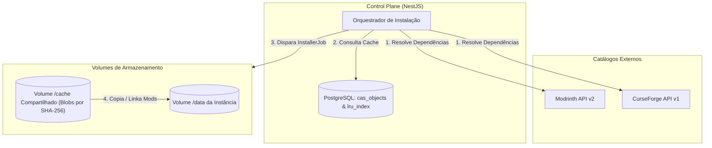
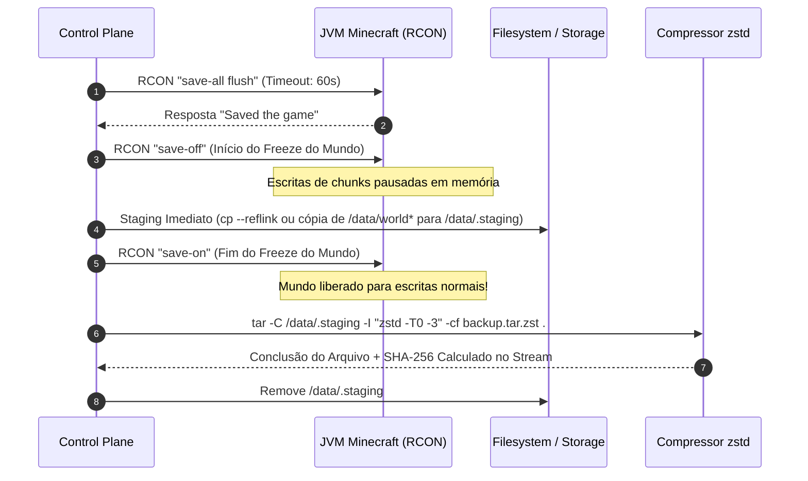

# Especificação de Requisitos de Software & Arquitetura (SRS)
## Módulo 05: Armazenamento, Modpacks & Backups Atômicos

**Metadados do Documento:**
- **Sistema:** MineKubernetes — Next-Gen Game Server Hypervisor
- **Módulo:** 05 — Storage Local, Gestão de Modpacks e Rotinas de Backup/Restore
- **Fase de Referência:** F0 — Consolidar SRS
- **Issues Resolvidas:** [#10](https://github.com/BGLuis/mineK8s/issues/10) (E-08), [#11](https://github.com/BGLuis/mineK8s/issues/11) (D-01), [#12](https://github.com/BGLuis/mineK8s/issues/12) (D-02), [#13](https://github.com/BGLuis/mineK8s/issues/13) (D-03), [#14](https://github.com/BGLuis/mineK8s/issues/14) (D-04), [#15](https://github.com/BGLuis/mineK8s/issues/15) (D-05), [#30](https://github.com/BGLuis/mineK8s/issues/30) (C-15), [#33](https://github.com/BGLuis/mineK8s/issues/33) (C-18), [#39](https://github.com/BGLuis/mineK8s/issues/39) (L-05), [#40](https://github.com/BGLuis/mineK8s/issues/40) (L-06), [#41](https://github.com/BGLuis/mineK8s/issues/41) (L-07)

---

## 1. Arquitetura de Armazenamento Local & Quotas (Resolução [#10], [#39])

O armazenamento principal das instâncias (`/data`) é provido pelo provisionador `local-path` do Kubernetes, que mapeia diretórios dedicados diretamente no disco NVMe/SSD do host.

### 1.1 Mitigação da Ausência de Quotas no local-path (Resolução [#10] / E-08)
O provisionador `local-path` do Kubernetes não impõe quotas de disco em nível de sistema de arquivos ext4/XFS padrão. Para evitar o esgotamento do disco do host por mundos em crescimento desenfreado:
1. **Monitoramento Ativo pelo Control Plane:** Um worker periódico do Control Plane consulta o espaço utilizado de cada volume via chamadas de sistema (`statvfs` e cálculo assíncrono de tamanho de diretório).
2. **Thresholds Operacionais:**
   - **75% da capacidade contratada:** Alerta de aviso na UI do administrador.
   - **90% da capacidade:** Notificação crítica e suspensão automática de tarefas de pré-geração de chunks.
   - **85% de ocupação do disco global do host:** Bloqueio da criação de novas instâncias e downloads de novos modpacks.

### 1.2 Exclusividade de Acesso ao Volume (Resolução [#39] / L-05)
Comandos como `fuser` executados dentro de containers não enxergam processos de outros namespaces de PID do host. A garantia de que nenhum processo está escrevendo no volume durante restaurações ou manutenções é assegurada pelo modelo de orquestração declarativa:
- O Control Plane escala a instância para `replicas: 0` e aguarda a confirmação de encerramento do Pod (`PodDeleted`/`Terminated`) antes de despachar qualquer Job de restauração.

---

## 2. Ingestão de Modpacks & Cache CAS no PostgreSQL (Resolução [#33], [#41])



### 2.1 Desacoplamento: `InstallerJob` vs `GamePod` Runner (Resolução [#33] / C-18)
Para evitar scripts imprevisíveis e dependências ocultas de imagens de terceiros:
1. **`InstallerJob`:** Pod efêmero executado durante a fase `PROVISIONING` ou `UPDATING`. Responsável por consultar a API do Modrinth/CurseForge, baixar os mods necessários, validar seus hashes SHA-1/SHA-256, armazená-los no cache CAS e escrever o arquivo `server.properties` padronizado.
2. **`GamePod` (Runner):** Pod limpo baseado em imagem oficial OpenJDK 21 (`eclipse-temurin:21-jre-jammy`). Executa unicamente o Java com os argumentos declarados pelo Hypervisor (Aikar's Flags) e a JAR do servidor (`server.jar`).

### 2.2 Índice CAS no PostgreSQL (Resolução [#41] / L-07)
O cache compartilhado `/cache` armazena arquivos indexados pelo hash de conteúdo (Content Addressable Storage). O índice LRU de arquivos não reside em arquivo SQLite no volume compartilhado (o que causa locks concorrentes), mas sim no banco relacional PostgreSQL do Control Plane:
```sql
CREATE TABLE cas_objects (
    sha256 VARCHAR(64) PRIMARY KEY,
    file_size BIGINT NOT NULL,
    file_name VARCHAR(255) NOT NULL,
    content_type VARCHAR(100) NOT NULL,
    last_accessed_at TIMESTAMPTZ NOT NULL DEFAULT NOW(),
    created_at TIMESTAMPTZ NOT NULL DEFAULT NOW()
);
```

### 2.3 Configuração de Chat Seguro (Resolução [#30] / C-15)
O `InstallerJob` injeta determinística e obrigatoriamente a propriedade `enforce-secure-chat=false` no arquivo `server.properties`. Essa configuração garante compatibilidade com conexões offline e convidados autenticados via Tailscale sem exigir chaves criptográficas assinadas pela Mojang.

---

## 3. Hot Backup Seguro com Consistência Atômica (Resolução [#11], [#12], [#13], [#14], [#40])

### 3.1 O Problema da Escrita In-Place no Minecraft (Resolução [#13] / D-03)
O formato Anvil (`.mca`) do Minecraft atualiza regiões de chunks **in-place** (sobrescrevendo setores diretamente dentro do arquivo existente). 
Se um snapshot for feito via hardlinks (`cp -al`) e o servidor reativar a escrita com `save-on`, qualquer nova alteração no mundo escreve no mesmo inode. Caso o utilitário de compressão (`tar`) ainda esteja lendo os hardlinks, o backup sofrerá **corrupção de leitura dividida (*torn read*)**.

### 3.2 O Algoritmo Canônico de Hot Backup
O Hypervisor resolve a consistência atômica através do pipeline com **staging isolado e freeze cronometrado**:



1. **Flush e Congelamento:** Emite `/save-all flush` para descarregar o cache da JVM para o disco. Em seguida, emite `/save-off`.
2. **Staging Imediato:** Copia todas as pastas de mundo (`world/`, `world_nether/`, `world_the_end/` e dimensões customizadas — Resolução **D-02**) para `/data/.staging/`.
   - Se o filesystem suportar CoW (Btrfs/XFS com reflink): utiliza `cp --reflink=always`, executando a operação em menos de **100 milissegundos**.
   - Se for ext4 tradicional: copia os arquivos essenciais de região de forma sequencial rápida.
3. **Descongelamento Instantâneo:** Assim que o staging é concluído, o comando `/save-on` é enviado via RCON. O jogo volta a operar normalmente com latência de freeze tipicamente inferior a 1,5 segundos (Resolução **D-04**).
4. **Compressão Isolada:** O utilitário `tar` empacota estritamente o conteúdo de `/data/.staging/`, sem tocar nos arquivos vivos de `/data/` (Resolução **D-01**).
5. **Nomenclatura e Metadados (Resolução [#40] / L-06):**
   - O arquivo é salvo como `{serverId}_{timestamp}_{backupType}.tar.zst`.
   - O hash SHA-256 é calculado durante o streaming do `tar` para o storage de destino e salvo na tabela `backups` do banco.

---

## 4. Script de Restauração Atômica com Rollback (Resolução [#15] / D-05)

A restauração de um backup sobrescreve o estado do servidor e deve ser transacional e resiliente a falhas:

1. **Validação de Pré-Condições:**
   - A instância é desligada (`replicas: 0`).
   - O Pod de restauração é agendado no mesmo nó onde o volume local reside (`nodeAffinity`).
2. **Verificação de Integridade Criptográfica:**
   - O hash SHA-256 do arquivo `.tar.zst` é validado contra o banco antes de qualquer mutação de disco. Se houver divergência, a restauração é abortada.
3. **Backup de Segurança (`PRE_RESTORE`):**
   - O conteúdo atual de `/data/` é movido atomicamente para `/data/.pre_restore_backup/`.
4. **Extração Limpa:**
   - Os arquivos de `/data/` são limpos (preservando o diretório de sistema `lost+found`).
   - O arquivo é extraído com `tar -I zstd -xf backup.tar.zst -C /data/`.
5. **Rollback Automático:**
   - Se a descompressão falhar, o conteúdo de `/data/.pre_restore_backup/` é restaurado imediatamente para a raiz de `/data/`.
   - Se a descompressão for bem-sucedida, o backup temporário é deletado e o servidor é autorizado a iniciar.
