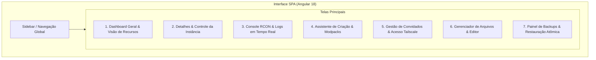

# Especificação de Requisitos de Software & Arquitetura (SRS)
## Módulo 06: Control Plane, API & Interface Web (SPA)

**Metadados do Documento:**
- **Sistema:** MineKubernetes — Next-Gen Game Server Hypervisor
- **Módulo:** 06 — Control Plane API, Segurança e Interface Web SPA
- **Fase de Referência:** F0 — Consolidar SRS
- **Issues Resolvidas:** [#17](https://github.com/BGLuis/mineK8s/issues/17) (C-02), [#35](https://github.com/BGLuis/mineK8s/issues/35) (L-01), [#36](https://github.com/BGLuis/mineK8s/issues/36) (L-02), [#38](https://github.com/BGLuis/mineK8s/issues/38) (L-04), [#43](https://github.com/BGLuis/mineK8s/issues/43) (L-09)

---

## 1. Arquitetura do Control Plane (NestJS + TypeORM)

O **Control Plane** é o cérebro administrativo do Hypervisor. Desenvolvido sobre **Node.js 20+** com o framework **NestJS**, ele expõe:
1. **API RESTful Protegida:** Para gestão de instâncias, usuários, convites, arquivos e backups.
2. **Gateway WebSocket:** Para streaming de logs de Pods e console interativo RCON em tempo real.
3. **Reconciliador Declarativo & Workers:** Tarefas em background para desligamento por inatividade (Sleep Mode), monitoramento de discos e coleta de métricas.

---

## 2. Esquema Relacional & Integridade Referencial (Resolução [#17], [#36])

O banco de dados oficial é o **PostgreSQL 16**, mapeado exclusivamente via **TypeORM** (eliminando referências descontinuadas a Prisma).

### 2.1 Modelo de Entidades e Cascata de Deleção (Resolução [#36] / L-02)
Para prevenir registros órfãos ao deletar um servidor ou usuário, todas as tabelas de associação possuem `ON DELETE CASCADE`:

```sql
CREATE TABLE servers (
    id UUID PRIMARY KEY DEFAULT gen_random_uuid(),
    name VARCHAR(100) NOT NULL,
    subdomain VARCHAR(63) NOT NULL UNIQUE,
    server_type VARCHAR(30) NOT NULL, -- VANILLA, PAPER, FORGE, NEOFORGE, FABRIC
    game_version VARCHAR(20) NOT NULL,
    modpack_id VARCHAR(100),
    allocated_memory_mb INT NOT NULL DEFAULT 4096,
    state VARCHAR(20) NOT NULL DEFAULT 'STOPPED',
    is_maintenance BOOLEAN NOT NULL DEFAULT false,
    auto_wake BOOLEAN NOT NULL DEFAULT true,
    sleep_timeout_minutes INT NOT NULL DEFAULT 15,
    created_at TIMESTAMPTZ NOT NULL DEFAULT NOW(),
    updated_at TIMESTAMPTZ NOT NULL DEFAULT NOW()
);

CREATE TABLE server_groups (
    id UUID PRIMARY KEY DEFAULT gen_random_uuid(),
    name VARCHAR(50) NOT NULL,
    server_id UUID NOT NULL,
    created_at TIMESTAMPTZ NOT NULL DEFAULT NOW(),
    CONSTRAINT fk_server_groups_server FOREIGN KEY (server_id)
        REFERENCES servers(id) ON DELETE CASCADE
);

CREATE TABLE user_server_access (
    id UUID PRIMARY KEY DEFAULT gen_random_uuid(),
    user_id UUID NOT NULL,
    server_id UUID NOT NULL,
    granted_at TIMESTAMPTZ NOT NULL DEFAULT NOW(),
    CONSTRAINT fk_user_access_user FOREIGN KEY (user_id)
        REFERENCES users(id) ON DELETE CASCADE,
    CONSTRAINT fk_user_access_server FOREIGN KEY (server_id)
        REFERENCES servers(id) ON DELETE CASCADE,
    CONSTRAINT uq_user_server UNIQUE (user_id, server_id)
);
```

---

## 3. Segurança no Gerenciador de Arquivos & Uploads (Resolução [#38] / L-04)

O Control Plane expõe endpoints para manipulação direta de arquivos do volume `/data` das instâncias (leitura de configs, logs, upload de mundos ou plugins em `.zip`).

### 3.1 Prevenção de Zip-Slip e Symlink Traversal
Para neutralizar vetores de travessia de diretório (*Directory Traversal*) e ataques de Zip-Slip:
1. **Verificação Canônica de Caminho:**
   ```typescript
   export function resolveSafePath(serverRoot: string, relativePath: string): string {
     const safeTarget = path.resolve(serverRoot, relativePath);
     if (!safeTarget.startsWith(serverRoot)) {
       throw new ForbiddenException('Acesso negado: Tentativa de Directory Traversal');
     }
     return safeTarget;
   }
   ```
2. **Rejeição de Links Simbólicos Fora do Volume:**
   - Ao inspecionar arquivos ou listar diretórios, o backend valida com `fs.lstatSync`. Se o arquivo for um link simbólico cujo alvo (`fs.realpathSync`) aponte para fora do diretório `/data` da instância, a operação é rejeitada com erro `403 Forbidden`.
3. **Extração Segura de `.zip`:**
   - Durante descompressão de arquivos `.zip`, cada entrada do manifesto tem seu caminho validado antes de ser gravada em disco. Entradas contendo sequências `../` ou caminhos absolutos são descartadas e bloqueadas.

### 3.2 Formato único de erro da API HTTP

Toda resposta de erro HTTP (4xx/5xx) segue o corpo abaixo, emitido pelo `ApiExceptionFilter` (`services/control-plane/src/common/filters/api-exception.filter.ts`). A SPA mapeia por `code` e exibe `message` sem inspecionar texto.

```json
{ "statusCode": 400, "code": "VALIDATION_ERROR", "message": "texto em pt-BR", "details": ["opcional, uma entrada por campo inválido"] }
```

| `code` | Quando |
|---|---|
| `VALIDATION_ERROR` | Falha do `ValidationPipe`; `message` junta os `details` |
| `BAD_REQUEST`, `UNAUTHORIZED`, `FORBIDDEN`, `NOT_FOUND`, `CONFLICT`, `PAYLOAD_TOO_LARGE`, `TOO_MANY_REQUESTS` | Status HTTP correspondente |
| `INTERNAL_ERROR` | Erro inesperado; a mensagem é genérica e o detalhe fica só no log |

---

## 4. Especificação da Interface Web SPA (Angular 18+) (Resolução [#43] / L-09)

A interface administrativa é uma aplicação de página única (**Single Page Application**) construída em **Angular 18+**, otimizada para alta densidade de informação e tempo de resposta instantâneo.



### 4.1 Especificação Funcional das Telas

#### Tela 1: Dashboard Geral
- **Objetivo:** Visão macro da infraestrutura e dos mundos.
- **Componentes:**
  - Cards de métricas do nó: Uso de CPU, memória RAM total/alocada e espaço disponível no NVMe.
  - Indicador de status da malha Tailscale (Dispositivos ativos vs Cota de 50 nós).
  - Tabela/Grid de Servidores com chips de estado (`READY`, `STOPPED`, `STARTING`, `CRASHED`), contagem de jogadores online e botão rápido de Start/Stop.

#### Tela 2: Detalhes do Servidor
- **Objetivo:** Painel de controle operacional de um mundo específico.
- **Componentes:**
  - Header com estado em tempo real (via WebSocket), botão de parada rápida, reinicialização e alternância de Modo Manutenção (`is_maintenance`).
  - Gráfico de latência de tick (TPS) e consumo de memória da JVM.
  - Lista de jogadores atualmente conectados com tempo de sessão e ação de expulsar (`kick`).
  - Configurações rápidas: Alocação de RAM (`-Xmx`), timeout de hibernação por inatividade (`sleep_timeout_minutes`) e subdomínio virtual.

#### Tela 3: Console RCON & Logs em Tempo Real
- **Objetivo:** Terminal interativo bidirecional para operadores.
- **Componentes:**
  - Viewport de terminal xterm.js conectado ao WebSocket `/ws/servers/:id/terminal`.
  - Seletor de visualização: **Logs do Processo (stdout/stderr)** ou **Console Interativo RCON**.
  - Campo de entrada de comandos com histórico acessível pelas setas do teclado ($\uparrow$/$\downarrow$).
  - Filtro rápido de logs por nível (`INFO`, `WARN`, `ERROR`).

#### Tela 4: Assistente de Criação de Servidores & Modpacks
- **Objetivo:** Provisionamento declarativo de novos servidores em menos de 1 minuto.
- **Componentes:**
  - **Passo 1 (Perfil):** Escolha do tipo de servidor:
    - *Vanilla* (Download oficial Mojang).
    - *Paper / Purpur* (Otimizado para performance e plugins).
    - *Modpack Modrinth* (Busca direta no catálogo v2 do Modrinth com seletor de versão).
    - *Modpack CurseForge* (Busca no catálogo v1 do CurseForge com resolução automática de modloader).
  - **Passo 2 (Recursos):** Sliders de memória RAM (com cálculo automático da margem do container: Heap + 1.5 GiB).
  - **Passo 3 (Rede):** Definição do subdomínio interno (ex.: `pixelmon.mine.internal`).

#### Tela 5: Gestão de Convidados, Acesso & Identidade
- **Objetivo:** Controle Zero-Trust e emissão de links de onboarding.
- **Componentes:**
  - Gerador de convites com configuração de nome, prazo de validade, limite de usos e servidores permitidos.
  - Link de convite com botão de cópia rápida (`https://join.<dominio>/?token=...`).
  - Tabela de jogadores autorizados com cruzamento de nickname Minecraft, IP do Tailscale e status na VPN.
  - Revogação de acesso em 1 clique (desconecta o jogador e bloqueia novas conexões).

#### Tela 6: Gerenciador de Arquivos (File Manager)
- **Objetivo:** Edição de arquivos de configuração e manipulação de mods sem necessidade de SSH/FTP.
- **Componentes:**
  - Árvore de diretórios e lista de arquivos de `/data`.
  - Editor de texto embutido (Monaco Editor / Ace) com destaque de sintaxe para `.properties`, `.yml`, `.json`, `.toml`.
  - Botão de upload de arquivos com verificação estrita de segurança e extração assistida de `.zip`.

#### Tela 7: Painel de Backups & Restauração
- **Objetivo:** Gestão de salvaguardas e recuperação de desastres.
- **Componentes:**
  - Botão de disparo de **Hot Backup Manual** (com exibição da latência de freeze em tempo real).
  - Lista histórica de backups contendo timestamp, tamanho compactado, hash SHA-256 e tipo (`MANUAL`, `SCHEDULED`, `PRE_RESTORE`).
  - Ação de **Restauração Atômica**: aciona modal com confirmação explícita, criação do backup de segurança automático e execução com rollback garantido.
